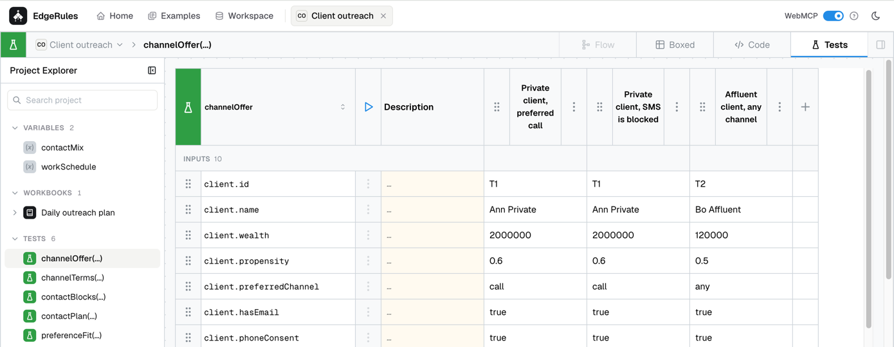

# Bugs

## Tests View

- [ ] Develop Tests Overview and put a link to it below `Overview` in project context menu. Rename project context menu
  item `Overview` to `Project Overview`
- [ ] `Tests Overview` should be a screen that aggregates all test results.
- [ ] In project overview page, where is `Tests` panel, when I run all I should see that tests are running (maybe
  loading icon) and then I should see how many passed. Ensure it is well-designed.
- [ ] In project overview page, `Tests` I should be able to see a button "All Tests" that will bring me to
  `Tests Overview`
- [ ] Fix single test GUI: 
  - [ ] There are two vertical scrollbars instead of one
  - [ ] There should be no white space on the right - I should see React Flow like background.