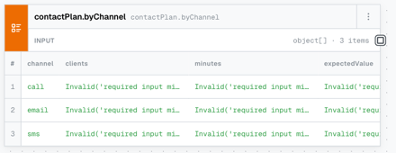

# Bugs

## General

- [ ] `optimise contactMix` and `loop workSchedule` should be recognized as methods, not variables. Check Project
  Explorer after fixing.
- [ ] When I open service `contactPlan(...)` in `http://localhost:5173/project/client-outreach/contactPlan?view=flow`, I
  see a lot of errors in nodes:  - also, nodes are not wired. Check `contactPlan` nodes.
- [ ] When I open action type `http://localhost:5173/project/client-outreach/Action`, I see Boxed editor with `Type`,
  but no Type name, such as `Action`. For example `http://localhost:5173/project/client-outreach/allowedFlag` works
  well, because I see `Function` and below `allowedFlag`
- [ ] There is no possibility to add a Fact in `Facts Library` - add an ability to do that. Before adding a fact, a
  popup should propose dropdown with existing types so user can select type that will be used by the new Fact.
- [ ] `http://localhost:5173/project/client-outreach/contactPlan?view=flow` service method in Project Explorer should be
  expandable as `Workbook` is. When I expand workbook, then I see all nodes. Same should be with service method.
- [ ] From project overview `http://localhost:5173/project/client-outreach?view=flow` remove `Run tests` and
  `Whole model` buttons, because we already have `Tests` panel and whole model can be checked by looking at code or
  boxed views.
- [ ] In project overview rename `Entry points` to `Service Methods`. Then make sure `Service Methods` overview looks
  the same as Workbooks: service methods are in panel blocks, I have big blocked "+ New Service method", I also have
  counter of how many created.

## Tests View

- [ ] Develop Tests Overview and put a link to it below `Overview` in project context menu. Rename project context menu
  item `Overview` to `Project Overview`
- [ ] `Tests Overview` should be a screen that aggregates all test results.
- [ ] In project overview page, where is `Tests` panel, when I run all I should see that tests are running (maybe
  loading icon) and then I should see how many passed. Ensure it is well-designed.
- [ ] In project overview page, `Tests` I should be able to see a button "All Tests" that will bring me to
  `Tests Overview`