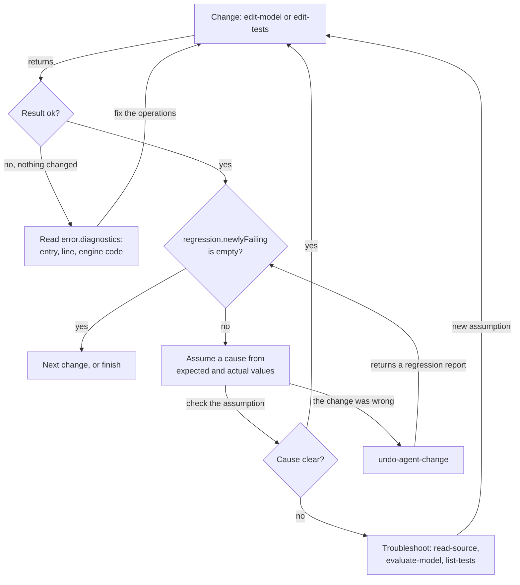
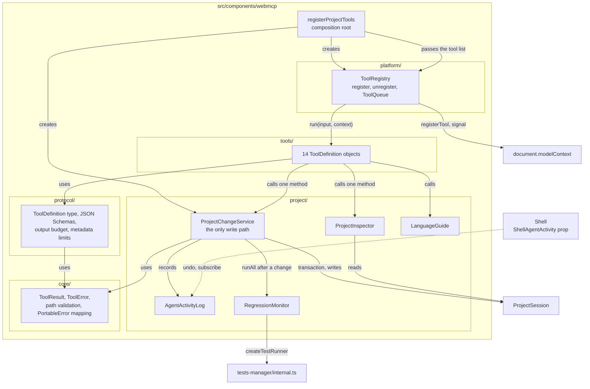

# WebMCP Companion Tools

## Summary

A companion LLM agent in the browser changes the project that is open in the Modeler. The page registers WebMCP tools
for the agent with `document.modelContext.registerTool`.

The contract is the [WebMCP draft](https://webmachinelearning.github.io/webmcp/) of the W3C Web Machine Learning CG, 10
November 2026.

The agent works in a change-and-react loop. Each change reports its outcome: link errors, or the failed test cases.

A failed test case comes with its expected and actual values. The agent reads the model only to troubleshoot.

Goals:

- **Outcome feedback:** each model or test write links the model and runs every test case of the project. The result
  names each problem exactly. The agent does not read the project back to verify a change.
- **One authority:** every tool goes through the open `ProjectSession`. The tools keep no copy of the model.
- **Safe changes:** a write is atomic. It changes the project only when the model still parses and links.
- **Cheap undo:** each write records the inverse of each operation. An undo replays the inverse operations and reports
  its outcome like any write.
- **Small context:** each tool does one task, has a short description, and returns compact JSON.
- **No backend:** the tools run in the page. They use no server, no network and no secret.

The new component `webmcp` (`edgerules-react/webmcp`) owns the tools. The host registers them once per open project.

## Phases

Each phase file holds the technical breakdown, the tasks and the acceptance criteria of one phase. It names the sections
of this file that it needs.

| Phase | File                                                              | Scope                                                    | Recommended model | Depends on     |
| ----- | ----------------------------------------------------------------- | -------------------------------------------------------- | ----------------- | -------------- |
| 1     | [phase-1-foundation.md](webmcp-story/phase-1-foundation.md)       | Layers, registration, `RegressionMonitor`, `run-tests`   | Opus              | Nothing        |
| 2     | [phase-2-change-tools.md](webmcp-story/phase-2-change-tools.md)   | Change tools, inverse operations, undo                   | Opus              | Phase 1        |
| 3     | [phase-3-inspect-tools.md](webmcp-story/phase-3-inspect-tools.md) | Orient and inspect tools, language guide                 | Sonnet            | Phase 1        |
| 4     | [phase-4-host-shell.md](webmcp-story/phase-4-host-shell.md)       | Host actions, Shell toast, Code view conflict, inspector | Opus              | Phases 2 and 3 |
| 5     | [phase-5-scenarios.md](webmcp-story/phase-5-scenarios.md)         | Change-and-react scenario replays                        | Sonnet            | Phase 4        |
| E2E   | [phase-e2e.md](webmcp-story/phase-e2e.md)                         | Playwright WebMCP flows                                  | Sonnet            | Phase 4        |
| X     | [phase-x-docs.md](webmcp-story/phase-x-docs.md)                   | Architecture documents, ADRs, README, review             | Sonnet            | Phases 5, E2E  |

- Phases 2 and 3 MAY run in parallel after Phase 1.
- Implement one phase per session: `/implement-story-phase @docs/stories/webmcp-story/<phase file>`.
- The phase file holds the checkboxes. This file holds no tasks.

## Technical Breakdown

### WebMCP platform contract

The tools use only the API of the draft. This table lists the parts that the component uses.

| Platform feature                      | Use in this story                                                                      |
| ------------------------------------- | -------------------------------------------------------------------------------------- |
| `document.modelContext`               | Entry point. `[SecureContext]`: only on HTTPS and `localhost`.                         |
| `registerTool(tool, {signal})`        | Registers one tool. Aborting `signal` unregisters it. There is no `unregisterTool`.    |
| `ModelContextTool.name`               | ASCII letters, digits, `_`, `-`, `.`; 1 to 128 characters. Duplicate names reject.     |
| `title`, `description`, `inputSchema` | Human label, agent-facing text, JSON Schema of the input object.                       |
| `outputSchema`                        | JSON Schema of the result object.                                                      |
| `execute(input, {signal})`            | Returns a `Promise`. The browser serializes the fulfilled value to a JSON string.      |
| `annotations.readOnlyHint`            | The tool only reads project state.                                                     |
| `annotations.untrustedContentHint`    | The result contains authored text, which can hold a prompt injection.                  |
| `annotations.consequentialHint`       | The agent or the browser asks the user to confirm before the call.                     |
| `exposedTo`                           | Not set. Only same-origin documents and the browser agent see the tools.               |
| Permissions Policy feature `tools`    | Default allowlist `'self'`. A host MAY set `Permissions-Policy: tools=()` to turn off. |
| `toolactivated`, `toolcancel` events  | The Shell shows the running tool.                                                      |
| `getTools()`, `executeTool()`         | Not used. E2E tests use Playwright `page.webmcp.tools()` and `callTool()`.             |

> Clarification: a rejected `execute` promise reaches the agent as `OperationError` without the message. So a tool never
> rejects for a domain error. It returns the error envelope (see [Result envelope](#result-envelope)).

Chrome ships the API behind `chrome://flags/#enable-webmcp-testing` (Chromium 146 or later) and an origin trial.

TypeScript DOM types do not declare the API. The component declares the structural type `ModelContextLike`.

### The agent works in a change-and-react loop

The tools support this loop. The read tools are for the troubleshooting branch only.



### Component architecture

The `webmcp` component has five layers and one composition root. Each layer has one responsibility.

No import cycle exists between the layers. A layer imports only the layers that its row of the import table names.



| Layer       | Folder      | Responsibility                                                                       | Knows WebMCP | Knows `ProjectSession` |
| ----------- | ----------- | ------------------------------------------------------------------------------------ | ------------ | ---------------------- |
| Core        | `core/`     | Transport-neutral result envelope, error codes, path validation, `PortableError` map | No           | No                     |
| Project     | `project/`  | The project use cases: changes, undo, regression runs, inspection, language guide    | No           | Yes                    |
| Protocol    | `protocol/` | The tool contract: `ToolDefinition`, JSON Schema fragments, output budget, limits    | Types only   | No                     |
| Tools       | `tools/`    | One `ToolDefinition` for each tool: name, description, schemas, a call to `project/` | Types only   | No                     |
| Platform    | `platform/` | The WebMCP adapter: feature detection, registration, abort, `ToolQueue`              | Yes          | No                     |
| Composition | root files  | `registerProjectTools` builds the services and the tool list and registers them      | Yes          | Yes                    |

Each layer imports only the layers in its row:

| Layer       | May import                                                                                                            | MUST NOT import                                       |
| ----------- | --------------------------------------------------------------------------------------------------------------------- | ----------------------------------------------------- |
| `core/`     | `@edgerules/portable` types, `#lib`                                                                                   | Every other `webmcp` folder, every other component    |
| `project/`  | `core/`, `project-session`, `project-explorer/internal.ts`, `tests-manager/internal.ts`, `test-cases-service`, `#lib` | `protocol/`, `tools/`, `platform/`                    |
| `protocol/` | `core/`                                                                                                               | `project/`, `tools/`, `platform/`, other components   |
| `tools/`    | `core/`, `protocol/`, `project/` types and services                                                                   | `platform/`, `@edgerules/*`, `project-session` values |
| `platform/` | `core/`, `protocol/`                                                                                                  | `project/`, `tools/`, other components                |

These invariants hold:

- `ProjectChangeService` is the only module that calls `session.transaction`, `session.execute` or an engine write.
- `RegressionMonitor` is the only module that runs test cases. `ProjectChangeService` calls it after each change.
- `platform/` is the only folder that touches `document.modelContext`.
- A tool validates its input, calls one `project/` method and returns its `ToolResult`. A tool never calls another tool.
- `project/` has no WebMCP type. Another agent front end, for example an in-app chat, MAY reuse it.
- The Shell does not import `webmcp`. It declares the structural type `ShellAgentActivity`, and `AgentActivityLog`
  satisfies it.

The shared contracts between the layers:

```typescript
// protocol/toolDefinition.ts: one tool, without any WebMCP call.
interface ToolDefinition<I extends object, O extends object> {
  name: string;
  title: string;
  description: string;
  inputSchema: object;
  outputSchema: object;
  annotations: {readOnlyHint?: boolean; untrustedContentHint?: boolean; consequentialHint?: boolean};
  availability: 'always' | 'write' | 'navigation' | 'save'; // the registry registers it from the options
  run(input: I, context: ProjectToolsContext, signal: AbortSignal): Promise<ToolResult<O>>; // never rejects
}

// project/projectToolsContext.ts: everything a tool can reach.
interface ProjectToolsContext {
  changes: ProjectChangeService;
  inspector: ProjectInspector;
  regression: RegressionMonitor;
  guide: LanguageGuide;
  host: ProjectHostActions; // navigation and save, from the options
}
```

- Each phase file defines the contracts of the layer that it builds.

### Component folder layout

```text
src/components/webmcp/
├── index.ts                         # npm API: registerProjectTools, getModelContext, public types
├── internal.ts                      # package-internal API; empty until another component needs one
├── registerProjectTools.ts          # composition root: services, tool list, registry, handle
├── webmcp-types.ts                  # ProjectToolsOptions, ProjectToolsHandle, ProjectToolsNavigation
├── core/
│   ├── toolResult.ts                # ToolResult, ToolError, ToolErrorCode, ok(), fail()
│   ├── paths.ts                     # ModelPath, SourcePath and TestSubject validation
│   ├── portableErrors.ts            # PortableError to ToolError, ModelDiagnostic line, column, excerpt
│   └── limits.ts                    # the validation limits table
├── protocol/
│   ├── toolDefinition.ts            # ToolDefinition, availability
│   ├── schemas.ts                   # shared JSON Schema fragments: paths, operations, test values
│   ├── outputBudget.ts              # fitOutput and the character budgets
│   └── toolMetadata.ts              # name, description and parameter length checks
├── project/
│   ├── projectToolsContext.ts       # ProjectToolsContext and its factory
│   ├── projectHostActions.ts        # navigation and save adapters
│   ├── changes/
│   │   ├── projectChangeService.ts  # version check, transaction, activity record, regression run
│   │   ├── agentActivityLog.ts      # AgentChange list, canUndo, undo
│   │   ├── changeSummary.ts         # the summary text of a change
│   │   └── operations/
│   │       ├── appliedOperation.ts  # AppliedOperation, OperationApplier
│   │       ├── modelOperations.ts   # set, rename, remove and their inverses
│   │       ├── testOperations.ts    # add, update, remove case and their inverses
│   │       └── documentationOperations.ts
│   ├── regression/
│   │   ├── regressionMonitor.ts     # runAll, runSubject, baseline
│   │   └── regressionReport.ts      # RegressionReport, CaseFailure, classification and trimming
│   ├── inspection/
│   │   ├── projectInspector.ts      # the ProjectInspector facade
│   │   ├── projectOverview.ts
│   │   ├── modelOutline.ts          # buildSections to OutlineEntry pages
│   │   ├── sourceReader.ts          # getCode and README pages
│   │   ├── modelSearch.ts
│   │   ├── testSuiteView.ts
│   │   └── modelEvaluator.ts
│   └── guide/
│       ├── languageGuide.ts         # topics, sections, pages
│       ├── topics.ts                # GuideTopic to file map
│       ├── guide-source.json        # engine commit and file list of the copy
│       └── reference/               # copied *.md files of ../edgerules/docs/reference/
├── tools/
│   ├── toolCatalog.ts               # every ToolDefinition in catalog order
│   ├── change/
│   │   ├── editModel.ts
│   │   ├── editTests.ts
│   │   ├── setDocumentation.ts
│   │   └── undoAgentChange.ts
│   ├── feedback/
│   │   └── runTests.ts
│   ├── orient/
│   │   ├── getProjectOverview.ts
│   │   └── getLanguageGuide.ts
│   ├── inspect/
│   │   ├── listModelEntries.ts
│   │   ├── readSource.ts
│   │   ├── searchModel.ts
│   │   ├── listTests.ts
│   │   └── evaluateModel.ts
│   └── host/
│       ├── openInEditor.ts
│       └── saveProject.ts
├── platform/
│   ├── modelContext.ts              # ModelContextLike, ModelContextToolLike, getModelContext
│   ├── toolRegistry.ts              # AbortController, availability filter, re-registration
│   └── toolQueue.ts                 # one tool call at a time
├── testing/
│   ├── recordingModelContext.ts     # a ModelContextLike that records tools and runs execute
│   └── toolsFixture.ts              # a real @edgerules/node session with registered tools
└── __tests__/
    ├── core/                        # toolResult, paths, portableErrors
    ├── project/                     # changes, undo, regression, inspection, guide
    ├── tools/                       # one test file for each tool family, toolMetadata.test.ts
    ├── platform/                    # registry, queue, dispose
    └── scenarios/                   # change-and-react scenario fixtures and scenarios.test.ts

stories/components/webmcp/
└── ToolInspector.stories.tsx        # lists the tools and runs one with a JSON input

e2e/webmcp/
└── webmcp.spec.ts                   # Playwright page.webmcp flows

scripts/
└── sync-language-guide.mjs          # copies ../edgerules/docs/reference/ into project/guide/reference/
```

### Tool design rules

Each tool follows these rules. The rules come from the Chrome WebMCP best practices and the draft security section.

| Rule              | Requirement                                                                                                          |
| ----------------- | -------------------------------------------------------------------------------------------------------------------- |
| Name              | `verb-noun` in kebab-case, at most 30 characters. The verb states the exact effect.                                  |
| Description       | At most 500 characters. It states what the tool does and when to use it. It does not repeat the schema.              |
| Parameter         | At most 30 characters in a name and 150 characters in a description. Names use the code terms of this repository.    |
| Schema            | Loose: types, enums and required members only. The code validates strictly and returns `InvalidInput`.               |
| Granularity       | One tool does one task. No two tools return the same data or make the same change.                                   |
| Flow control      | No description orders the agent to call tools in a sequence. A description MAY name the tool that supplies an input. |
| Feedback          | Each model or test write returns its outcome: diagnostics on failure, a regression report on success.                |
| Output size       | List and status results fit in 1,500 characters. Text results page with `offset`.                                    |
| Concurrency       | A write MAY take `baseVersion`. It then fails with `VersionConflict` when the project changed.                       |
| Atomicity         | Each write is one `ProjectSession.transaction`. It changes all or nothing.                                           |
| Reversibility     | Each write returns a `changeId`. `undo-agent-change` replays its inverse operations.                                 |
| Untrusted content | Each tool that returns authored text sets `untrustedContentHint`.                                                    |
| Scope             | The tools reach only the open project. No tool lists, opens, deletes or copies other projects.                       |
| Abort             | A tool checks `signal` before its commit point. After the commit point, it completes and returns the result.         |

### Result envelope

Every tool returns `ToolResult<T>` from `core/toolResult.ts`. The `outputSchema` of each tool describes it.

```typescript
type ToolResult<T> = ({ok: true} & T) | {ok: false; error: ToolError};

interface ToolError {
  code: ToolErrorCode; // the discriminant the agent switches on
  message: string; // one sentence, at most 300 characters
  path?: string; // the model path the error is about
  operation?: number; // the index of the failed operation in a batch
  diagnostics?: ModelDiagnostic[]; // parse and link problems, at most 20
  currentVersion?: number; // with `VersionConflict`
  conflicts?: SourcePath[]; // with `UndoBlocked`: the targets that changed after the agent change
  hint?: string; // the next useful step, for example "Call list-tests to see the input paths"
}

type ToolErrorCode =
  | 'InvalidInput' // the input fails validation; `message` names the member
  | 'NotFound' // the path, the test subject or the test case does not exist
  | 'VersionConflict' // the project changed after `baseVersion`
  | 'ParseError' // the DSL does not parse
  | 'LinkError' // the model does not link after the change
  | 'DuplicateName' // a set or rename collides with an existing entry
  | 'ExecutionError' // the engine failed to evaluate
  | 'SolverRequired' // the target calls an external function that has no resolver
  | 'UndoBlocked' // a target of the agent change changed later; `conflicts` names the targets
  | 'SaveConflict' // the repository has a newer revision
  | 'Aborted' // the agent aborted the call before its commit point
  | 'InternalError'; // an unexpected exception; `ToolRegistry` catches it, so `execute` never rejects

interface ModelDiagnostic {
  source: 'parser' | 'linker';
  code?: string; // the engine code, for example `E101` or `UnexpectedToken`
  message: string;
  path?: string; // the entry that holds the problem
  line?: number; // 1-based, in the code of `path`
  column?: number; // 1-based
  excerpt?: string; // the source line, at most 120 characters
}
```

- A tool maps each `PortableError` to a `ToolError`. `EntryNotFound` maps to `NotFound`. `DuplicateName` maps to
  `DuplicateName`. `Parse`, `Linking` and `Execution` map to `ParseError`, `LinkError` and `ExecutionError`.
- A tool rejects only with `AbortError`, and only before its commit point.

### Shared input types

```typescript
// '*' for the whole model, or a dotted model path, for example 'applicant.age' or 'library.eligibility'.
type ModelPath = string;

// A model path, or the document path 'doc:README.md'. A model path never contains ':'.
type SourcePath = string;

// The Project Explorer sections that hold model entries.
type ModelSection = 'types' | 'factsLibrary' | 'methods' | 'decisions' | 'services' | 'variables' | 'workbooks';

// '*' for the tests of the whole model, otherwise the path of a callable (`TestSubjectId`).
type TestSubject = string;
```

Validation limits:

| Input                     | Limit                                                               |
| ------------------------- | ------------------------------------------------------------------- |
| `ModelPath`               | `*`, or segments that match `[A-Za-z_][A-Za-z0-9_]*`, joined by `.` |
| `SourcePath`              | A `ModelPath`, or `doc:README.md`                                   |
| `code` of one operation   | At most 50,000 characters                                           |
| `operations`, `items`     | 1 to 50 entries                                                     |
| Documentation `text`      | At most 20,000 characters                                           |
| Test value text           | At most 2,000 characters                                            |
| `limit` of a list         | 1 to 200; default 100                                               |
| `query` of `search-model` | 1 to 200 characters                                                 |

### Tool catalog

| #   | Tool                   | Kind     | `readOnlyHint` | `untrustedContentHint` | `consequentialHint` | Registered when                |
| --- | ---------------------- | -------- | -------------- | ---------------------- | ------------------- | ------------------------------ |
| 1   | `edit-model`           | Change   | false          | false                  | false               | Not `readOnly`                 |
| 2   | `edit-tests`           | Change   | false          | false                  | false               | Not `readOnly`                 |
| 3   | `set-documentation`    | Change   | false          | false                  | false               | Not `readOnly`                 |
| 4   | `undo-agent-change`    | Change   | false          | false                  | false               | Not `readOnly`                 |
| 5   | `run-tests`            | Feedback | true           | false                  | false               | Always                         |
| 6   | `get-project-overview` | Orient   | true           | true                   | false               | Always                         |
| 7   | `get-language-guide`   | Orient   | true           | false                  | false               | Always                         |
| 8   | `list-model-entries`   | Inspect  | true           | true                   | false               | Always                         |
| 9   | `read-source`          | Inspect  | true           | true                   | false               | Always                         |
| 10  | `search-model`         | Inspect  | true           | true                   | false               | Always                         |
| 11  | `list-tests`           | Inspect  | true           | true                   | false               | Always                         |
| 12  | `evaluate-model`       | Inspect  | true           | false                  | false               | Always                         |
| 13  | `open-in-editor`       | UI       | false          | false                  | false               | `navigation` is set            |
| 14  | `save-project`         | Persist  | false          | false                  | true                | Not `readOnly` and `allowSave` |

- **Change:** the daily tools. Each one returns its outcome.
- **Feedback:** an explicit regression run, for example after the user says they changed something.
- **Orient:** the first calls of a session.
- **Inspect:** the troubleshooting branch of the loop.

> Clarification: `run-tests` writes the in-memory test results that the Tests view shows. Results are derived data and
> are never saved, so the tool counts as read-only. A change tool is not consequential, because `undo-agent-change`
> reverts it and nothing persists before `save-project`.

The `text` block of each tool in its phase file is its exact `description` string. Each one is at most 500 characters.

### Security

| Threat                                   | Control                                                                                                     |
| ---------------------------------------- | ----------------------------------------------------------------------------------------------------------- |
| Prompt injection in model text or README | `untrustedContentHint` on each tool that returns authored text. Projects come from examples or other users. |
| Cross-origin actuation                   | No `exposedTo`. The `tools` Permissions Policy keeps the default `'self'`.                                  |
| Silent destructive change                | Atomic writes, a toast for each change, one-click undo. Nothing persists without `save-project`.            |
| Silent persistence                       | `save-project` is off by default and has `consequentialHint`.                                               |
| Lost user edit                           | Undo target checks. The Code view shows a conflict bar and does not overwrite silently.                     |
| Large or malformed input                 | Strict validation and the limits table. Errors return `InvalidInput` and change nothing.                    |
| Data exfiltration                        | No tool makes a network request, reads another project or reads browser storage outside the session.        |
| Over-parameterization                    | No tool takes personal data. Every parameter addresses project content.                                     |

## Architecture Changes

- New component `webmcp`, subpath export `edgerules-react/webmcp`. Allowlist: `project-session`, `project-explorer`,
  `test-cases-service`, `tests-manager`.
- `shell` keeps its allowlist. It declares `ShellAgentActivity`, and the host passes the activity log in.
- `.dependency-cruiser.cjs` gets the five `webmcp-layer-*` rules of the import table in
  [Component architecture](#component-architecture).
- `project-explorer/internal.ts` already exports `buildSections`.
- `tests-manager/internal.ts` (new) exports `deriveRows`, `listTestSubjects`, `createTestRunner`, `caseFailures`,
  `matches` and `formatValue`.
- `TestCasesService` gets `restoreTestCase`.
- `ProjectSession.execute` returns the rewritten paths of `renamePath`.
- `docs/architecture-adr.md` gets an ADR: a change tool returns its outcome (diagnostics or a regression report). The
  agent does not read the project back to verify a change.
- `docs/architecture-adr.md` gets an ADR: tools return an error envelope and do not reject for domain errors.
- `docs/architecture-adr.md` gets an ADR: one atomic `edit-model` with operations, not one tool per operation.
- `docs/architecture-adr.md` gets an ADR: an undo replays recorded inverse operations. It does not compare project
  snapshots.

## Out of Scope

- Workspace tools: list, open, create, copy or delete projects.
- Flow canvas layout: node positions, output nodes and chart nodes.
- Model metadata (`setModelMetadata`).
- The declarative WebMCP form API.
- A built-in chat panel. The agent is the browser agent or an extension.
- A WebMCP polyfill. A host MAY pass one as `modelContext`.

## Limitations

- Each model or test change runs every test case of the project. Its duration grows with the number of test cases.
- `newlyFailing` compares with the previous run. A user change between two runs also shows in it.
- The undo checks only its undo targets. A user edit of a reference that a rename rewrote is not checked.
- `search-model` matches text. The engine has no reference index, so a match in a comment or string is also a result.
- The Code view conflict bar shows no diff.
- The language guide is a copy. A change of `../edgerules/docs/reference/` needs a new sync run.
- Chrome recommends 1,500 characters per output. `read-source` pages have 4,000 characters, because a DSL declaration is
  often longer than 1,500.
- A tool works only while the project is open in the page.

## Future Improvements

- Run only the test cases that depend on the changed paths, when the engine exposes dependencies.
- A `find-references` tool when the engine exposes a reference index.
- A `get-builtin` tool when the engine ships the builtins catalog.
- Flow layout tools for workbooks.
- Evaluation with real LLM agents over the scenario set of Phase 5.

## Verification

| Check        | Command                |
| ------------ | ---------------------- |
| Build        | `npm run build`        |
| Typecheck    | `npm run typecheck`    |
| Lint         | `npm run lint`         |
| Format       | `npm run format:check` |
| Dependencies | `npm run depcruise`    |
| Test         | `npm test`             |
| E2E          | `npm run e2e`          |
| Storybook    | `npm run storybook`    |
| Start        | `npm run dev`          |
