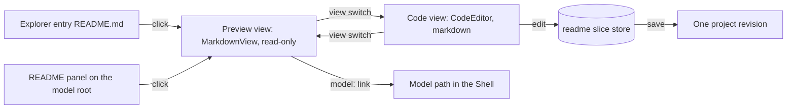
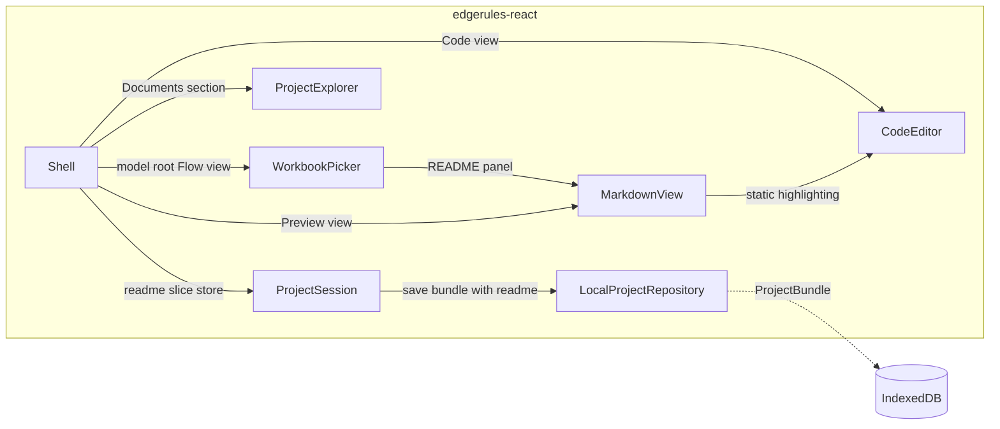

# Model README

## Summary

`README.md` is a standard slice of every EdgeRules project. It is the long description of the project, in GitHub
Flavored Markdown.

The Shell shows the README in two places:

- **Model root:** the Flow view of `*` shows a README panel above the workbook and service panels.
- **Document root:** the Project Explorer lists `README.md` in a Documents section. The Shell opens it with two views:
  Preview (`MarkdownView`, read-only) and Code (`CodeEditor`, editable Markdown).

Related stories:

- [examples-repository-story.md](examples-repository-story.md) stores a `README.md` in each example. It needs Phase 1 of
  this story.
- [examples-library-story.md](examples-library-story.md) shows the README of an example with `MarkdownView`.

## Technical Breakdown

### README is a project slice

`README.md` is at the project root, next to `edgerules.project.json`, and the manifest has no field for it.
`docs/descriptions.json` keeps the short description of each model path; the README is the long description.

| Project source                  | README content                                               |
| ------------------------------- | ------------------------------------------------------------ |
| Example of `edgerules-examples` | Authored `README.md` of the example                          |
| New project (`ProjectFactory`)  | Generated: `# <name>` and the `description`                  |
| Project of format version 2     | The migration to format 3 generates it, as for a new project |

- `PROJECT_FORMAT_VERSION` becomes 3. The migration from format 2 is pure, as the other migrations of
  `parseProjectBundle`.
- `ProjectSession` has a `readme` slice store. A save writes the README with the other slices in one revision.
- `LocalProjectRepository` stores the README in the bundle record. `exportBundle` returns it.
- A README MAY use GitHub Flavored Markdown: tables, task lists, fenced code, relative images. It MUST NOT contain raw
  HTML: `MarkdownView` drops it.

### README panel on the model root

The Flow view of the model root is the `WorkbookPicker`. The content of the model selects what the model root shows.

A README exists when its Markdown is not blank.

| Model content                         | Model root views | Flow view of the model root                                      |
| ------------------------------------- | ---------------- | ---------------------------------------------------------------- |
| At least one workbook or service      | Flow, Boxed      | README panel (if a README exists), Workbooks and Service Methods |
| A README, no workbook and no service  | Flow, Boxed      | The full README with `MarkdownView`, without a height limit      |
| No README, no workbook and no service | Boxed            | None                                                             |

- `rootViews` and `modelView` of the Shell use these rules. The breadcrumb of the model opens the Flow view when it
  exists, else the Boxed view.
- A model with a service and no workbook shows the Workbooks section with only the `New workbook` panel.

The layout of the README panel, the workbook panels and the service panels:

| Element                  | Layout                                                                                 |
| ------------------------ | -------------------------------------------------------------------------------------- |
| README panel             | Width of 3 panels and 2 gaps. Height of the content, at most 2 panel heights and 1 gap |
| README panel content     | `MarkdownView` of the README; content above the maximum height is cut off with a fade  |
| README panel footer      | `README.md` and the action `Open`                                                      |
| Workbook and service row | A grid of at most 3 panels per row; a narrow body shows fewer columns                  |
| Add panel                | The `New workbook` and `New service` panels are grid items, as the other panels        |

- A click on the README panel opens the document root `doc:README.md` in the `preview` view.
- The README panel is read-only. A `model:` link in it opens that model path.
- The `Overview` story of `Models/Loan Repayment` opens `*` in the `flow` view. It shows the README panel.
- `models/loan-repayment` gets an authored `README.md`.

### Documents in the Project Explorer

The Project Explorer has a Documents section, the first section of the tree. It lists the documents of the project.

This story has one document: `README.md`.

| Item              | Value                                                                 |
| ----------------- | --------------------------------------------------------------------- |
| Section           | `documents`                                                           |
| Entry kind        | `document`                                                            |
| Entry path        | `doc:README.md`                                                       |
| Entry label       | `README.md`                                                           |
| Source of entries | The `documents` prop; the explorer does not read them from the engine |
| Add button        | None                                                                  |

- A click on the `README.md` entry opens `doc:README.md` in the `preview` view.
- The `doc:` prefix marks a document path. A model path never contains `:`, so the two path forms cannot collide.

### Document root in the Shell

A document path is a root path of the Shell. The breadcrumbs show the model name and `README.md`.

The view switch of a document root shows only Preview and Code; Flow, Boxed and Tests are hidden.

| View      | Component                                | Behavior                                                                      |
| --------- | ---------------------------------------- | ----------------------------------------------------------------------------- |
| `preview` | `MarkdownView`                           | Default view. Rendered Markdown, read-only; `model:` links navigate the Shell |
| `code`    | `CodeEditor` with `language: 'markdown'` | Markdown source with highlighting; editable when the Shell is not read-only   |

- `ShellView` gets `'preview'`. Only a document root has it. A model or entity root falls back from `preview` to
  `boxed`.
- A document root falls back from `flow`, `boxed` and `tests` to `preview`.
- An edit in the Code view writes the `readme` slice store of the session. A save writes it with the other slices in one
  revision.
- `CodeEditor` gets the `language` prop: `'edgerules'` (the default) or `'markdown'`. With `'markdown'` the `service`
  prop is not used, and the editor has no diagnostics, completion or formatting.
- `@codemirror/lang-markdown` becomes an optional peer dependency.

The user opens and edits the README:



### Markdown viewer

`MarkdownView` renders a README in the Shell, and in other components such as the Examples Library. It uses
`@tanstack/markdown` (`parser`, `react` and the `autolinks` extension), as an optional peer dependency.

| Concern        | Rule                                                                                                  |
| -------------- | ----------------------------------------------------------------------------------------------------- |
| Safety         | Raw HTML is dropped. URL schemes other than `https`, `mailto`, `model` and relative paths are removed |
| Raw HTML       | The parser recognizes raw HTML; `MarkdownView` removes it from the document before it renders         |
| Autolinks      | A bare `https` URL becomes a link                                                                     |
| Relative URLs  | `resolveUrl(relative)` rewrites relative images and links, for example to a commit-pinned file URL    |
| Model links    | `[monthlyPayment](model:monthlyPayment)` calls `onModelLink(path)`; the Shell opens that path         |
| Code blocks    | `edgerules` fences use the static highlighter of `code-editor/language/highlight.ts`                  |
| External links | Open in a new tab with `rel="noopener noreferrer"`                                                    |
| Theme          | Mantine typography; light and dark                                                                    |

### Structural Diagram

The README components and their dependencies:



### TypeScript API

`project-session` changes:

```typescript
interface ProjectBundle {
  // ...existing members
  readme: string; // Markdown of README.md
}

interface ProjectBundleInput {
  // ...existing members
  readme?: string; // defaults to a README generated from `name` and `description`
}
```

`markdown-view` component, subpath export `edgerules-react/markdown-view`:

```typescript
interface MarkdownViewProps {
  markdown: string; // GitHub Flavored Markdown
  resolveUrl?: (relative: string) => string; // rewrites relative image and link URLs
  onModelLink?: (path: string) => void; // called for model: links; without it they render as text
}
```

`code-editor` change:

```typescript
interface CodeEditorProps {
  // ...existing members
  language?: 'edgerules' | 'markdown'; // default 'edgerules'; 'markdown' does not use `service`
}
```

`project-explorer` changes:

```typescript
type ExplorerSection = 'documents' | 'types' | 'methods' | 'services' | 'variables' | 'workbooks' | 'tests';

type ExplorerEntryKind = /* ...existing kinds */ 'document';

interface ProjectExplorerProps {
  // ...existing members
  documents?: readonly string[]; // document file names, e.g. 'README.md'; without it there is no Documents section
}
```

`shell` changes:

```typescript
type ShellView = 'code' | 'boxed' | 'flow' | 'tests' | 'preview'; // 'preview' only for a document root

interface ShellProps {
  // ...existing members
  path?: string; // '*', the path of an entity, or a document path such as 'doc:README.md'
}
```

## Architecture Changes

- `project-session`: `README.md` is a project slice (`ProjectBundle.readme`). `PROJECT_FORMAT_VERSION` becomes 3; the
  migration from 2 generates the README.
- New component `markdown-view`: public API `MarkdownView`. Optional peer `@tanstack/markdown`. It has no component
  dependency; it MAY import `code-editor/language/` files.
- `code-editor`: `language` prop. Optional peer `@codemirror/lang-markdown`.
- `project-explorer`: Documents section with `document` entries, from the `documents` prop.
- `shell`: document root paths (`doc:` prefix) with the `preview` and `code` views; README panel in the
  `WorkbookPicker`. Its allowlist gets `markdown-view`.

## Out of Scope

- Mermaid diagrams inside a README.
- A side-by-side editor with a live preview.
- Documents other than `README.md`.

## Future Improvements

- Per-entity Markdown documents (`docs/nodes/*.md`) after stable entity ids exist (`global-project-management.md` §6).
  They are listed in the Documents section.

## Verification

| Check     | Command                |
| --------- | ---------------------- |
| Build     | `npm run build`        |
| Typecheck | `npm run typecheck`    |
| Lint      | `npm run lint`         |
| Test      | `npm test`             |
| Rules     | `npm run depcruise`    |
| Format    | `npm run format:check` |
| E2E       | `npm run e2e`          |
| Start     | `npm run storybook`    |

## Tasks

**Phase 1: README slice in `project-session`**

- [x] Ensure project compiles and existing tests are passing
- [x] Add `ProjectBundle.readme` and `ProjectBundleInput.readme`
- [x] Generate the README in `ProjectFactory.createBundle` when the input has none
- [x] Add the format 2 to 3 migration to `parseProjectBundle`
- [x] Add the `readme` slice store to `ProjectSession`, and store the README in `LocalProjectRepository`
- [x] Add the README to `exportBundle`
- [x] Add tests for the code of this phase

Acceptance criteria:

- [x] `npm test` passes, including a migration test: a format 2 bundle opens with a generated README
- [x] `npm test` passes, including a session test: a README edit and a model edit save as one revision
- [x] `npm test` passes, including a factory test: a new project without a README gets `# <name>` and its description

**Phase 2: Markdown viewer**

- [x] Add `markdown-view` with `@tanstack/markdown` as an optional peer
- [x] Implement URL rewrite, scheme filter, `model:` links and `edgerules` code highlighting
- [x] Add the `language` prop to `CodeEditor` with `@codemirror/lang-markdown`
- [x] Add Storybook stories for `MarkdownView` and the Markdown `CodeEditor`
- [x] Add tests for the code of this phase

Acceptance criteria:

- [x] `npm test` passes, including `MarkdownView.test.tsx`: raw HTML and `javascript:` links do not render
- [x] `npm run depcruise` passes with the new component

**Phase 3: README in the Shell and the Project Explorer**

- [ ] Add the Documents section and the `documents` prop to `ProjectExplorer`
- [ ] Add document root paths and the `preview` view to the Shell; hide Flow, Boxed and Tests for a document root
- [ ] Show the README in the `preview` view with `MarkdownView`, and in the `code` view with `CodeEditor`
- [ ] Add the README panel to `WorkbookPicker`, and limit the workbook and service rows to 3 panels
- [ ] Show the model root Flow view for a model with a workbook, a service or a README
- [ ] Add an authored `README.md` to `models/loan-repayment`; open the `Overview` story in the `flow` view
- [ ] Add a Storybook story for the README document root
- [ ] Add tests for the code of this phase

Acceptance criteria:

- [ ] `npm test` passes, including a Project Explorer test: the Documents section lists `README.md`
- [ ] `npm test` passes, including a Shell test: a document root shows only Preview and Code in the view switch
- [ ] `npm test` passes, including a Shell test: the Preview view has no editor; a Code view edit marks the project
      dirty
- [ ] `npm test` passes, including a Shell test: the README panel on the model root opens the README in Preview
- [ ] `npm test` passes, including a Shell test: a model with only a README shows it in the root Flow view
- [ ] `npm test` passes, including a Shell test: a model without README, workbook or service has no root Flow view
- [ ] `npm test` passes, including a Shell test: a `model:` link in the README opens that model path

**Phase E2E:**

- [ ] Add E2E tests for the user flows of this story

Acceptance criteria:

- [ ] `npm run e2e` passes, including `model-readme.spec.ts`: open README from the explorer, edit in Code, save, reload,
      README kept

**Phase X:**

- [ ] Update `docs/architecture.md` with the changes from `## Architecture Changes`
- [ ] Update `README.md` with `MarkdownView`, the Documents section and the Shell document root
- [ ] Review the implementation against this story and the project conventions

Acceptance criteria:

- [ ] Every command in `## Verification` passes
- [ ] Storybook starts with `npm run storybook`; `Models/Loan Repayment` `Overview` shows the README panel above the
      workbooks
