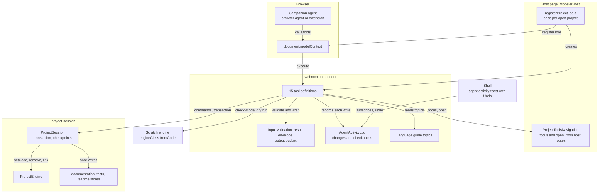
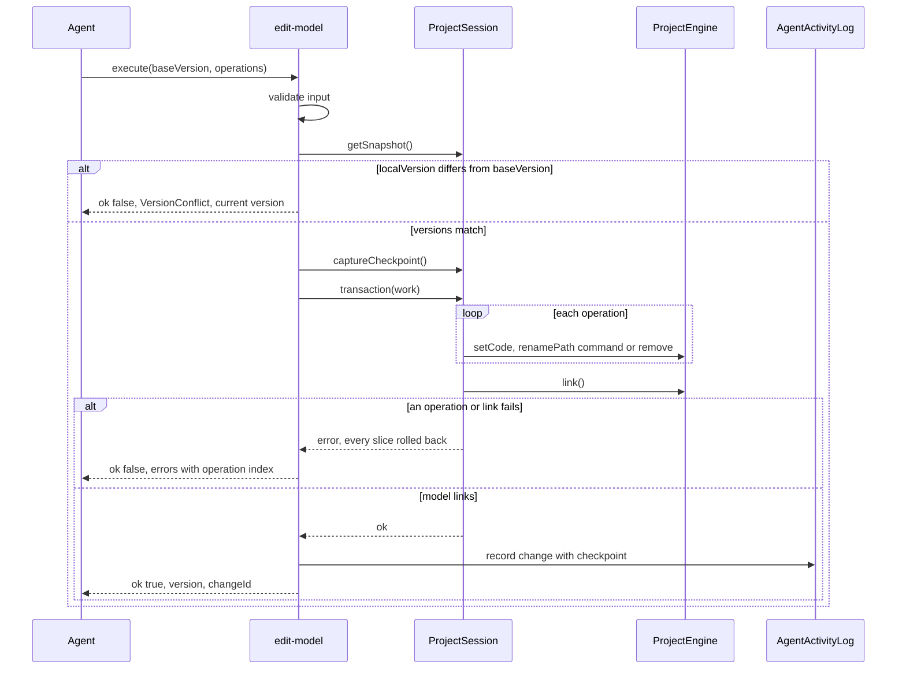
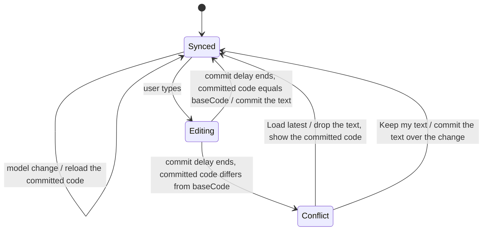

# WebMCP Companion Tools

## Summary

A companion LLM agent in the browser reads, checks, tests and edits the project that is open in the Modeler. The page
registers WebMCP tools for the agent with `document.modelContext.registerTool`.

The contract is the [WebMCP draft](https://webmachinelearning.github.io/webmcp/) of the W3C Web Machine Learning CG, 10
November 2026.

Goals:

- **One authority:** every tool goes through the open `ProjectSession`. The tools keep no copy of the model.
- **Safe edits:** a write is atomic and version-checked. It changes the project only when the model still parses and
  links. The user sees each agent change and can undo it.
- **Small context:** each tool does one task, has a short description, and returns compact JSON in pages.
- **No backend:** the tools run in the page. They use no server, no network and no secret.

The new component `webmcp` (`edgerules-react/webmcp`) owns the tools. The host registers them once per open project.

## Technical Breakdown

### WebMCP platform contract

The tools use only the API of the draft. This table lists the parts that the component uses.

| Platform feature                      | Use in this story                                                                      |
| ------------------------------------- | -------------------------------------------------------------------------------------- |
| `document.modelContext`               | Entry point. `[SecureContext]`: only on HTTPS and `localhost`.                         |
| `registerTool(tool, {signal})`        | Registers one tool. Aborting `signal` unregisters it. There is no `unregisterTool`.    |
| `ModelContextTool.name`               | ASCII letters, digits, `_`, `-`, `.`; 1 to 128 characters. Duplicate names reject.     |
| `title`, `description`, `inputSchema` | Human label, agent-facing text, JSON Schema of the input object.                       |
| `outputSchema`                        | JSON Schema of the result object.                                                      |
| `execute(input, {signal})`            | Returns a `Promise`. The browser serializes the fulfilled value to a JSON string.      |
| `annotations.readOnlyHint`            | The tool only reads project state.                                                     |
| `annotations.untrustedContentHint`    | The result contains authored text, which can hold a prompt injection.                  |
| `annotations.consequentialHint`       | The agent or the browser asks the user to confirm before the call.                     |
| `exposedTo`                           | Not set. Only same-origin documents and the browser agent see the tools.               |
| Permissions Policy feature `tools`    | Default allowlist `'self'`. A host MAY set `Permissions-Policy: tools=()` to turn off. |
| `toolactivated`, `toolcancel` events  | The Shell shows the running tool.                                                      |
| `getTools()`, `executeTool()`         | Not used. E2E tests use Playwright `page.webmcp.tools()` and `callTool()`.             |

> Clarification: a rejected `execute` promise reaches the agent as `OperationError` without the message. So a tool never
> rejects for a domain error. It returns the error envelope (see [Result envelope](#result-envelope)).

Chrome ships the API behind `chrome://flags/#enable-webmcp-testing` (Chromium 146 or later) and an origin trial.

TypeScript DOM types do not declare the API. The component declares the structural type `ModelContextLike`.

### Structural Diagram



### Behavioral Diagram

The `edit-model` tool changes the model in one session transaction:



### Tool registration lifecycle

- The host calls `registerProjectTools` after it opens a `ProjectSession`. It calls `dispose` before it closes the
  session.
- `registerProjectTools` does nothing and returns an inactive handle when `modelContext` is `undefined`.
- The handle registers every tool with one `AbortController`. `dispose` aborts it, so every tool unregisters.
- With `readOnly: true`, only the tools with `readOnlyHint` and `open-in-editor` register.
- `open-in-editor` registers only when `navigation` is set. `save-project` registers only when `allowSave` is `true`.
- `setReadOnly` and `setAllowSave` re-register the affected tools. The browser fires `toolchange`.
- The host MUST NOT register tools from editor components. One registration point exists per open project.

```typescript
// edgerules-react/webmcp: public API

// The structural subset of the WebMCP `ModelContext` that the component uses.
interface ModelContextLike {
  registerTool(tool: ModelContextToolLike, options?: {signal?: AbortSignal}): Promise<void>; // rejects on bad name
}

interface ModelContextToolLike {
  name: string; // kebab-case, at most 30 characters
  title: string; // label for a confirmation dialog
  description: string; // at most 500 characters
  inputSchema: object; // JSON Schema draft 2020-12, `type: 'object'`
  outputSchema: object; // JSON Schema of `ToolResult<T>`
  annotations: {readOnlyHint?: boolean; untrustedContentHint?: boolean; consequentialHint?: boolean};
  execute(input: object, options: {signal: AbortSignal}): Promise<ToolResult<unknown>>; // never rejects for a domain error
}

// `document.modelContext` when the browser has it; `undefined` otherwise.
function getModelContext(doc?: Document): ModelContextLike | undefined;

interface ProjectToolsOptions {
  modelContext: ModelContextLike | undefined; // `getModelContext()`, or a polyfill of the host
  session: ProjectSession; // the open project
  engineClass: ProjectToolsEngineClass; // `MutableDecisionService`: scratch engines and static diagnostics
  navigation?: ProjectToolsNavigation; // enables `open-in-editor` and the `focus` of `get-project-overview`
  readOnly?: boolean; // registers only read tools; default false
  allowSave?: boolean; // registers `save-project`; default false
}

// `ProjectEngineClass` with the static diagnostics of the engine class.
interface ProjectToolsEngineClass extends ProjectEngineClass {
  diagnostics(code: string): EditorDiagnostic[]; // parse and link problems of a whole DSL document
}

// Implemented by the host from its routes; the Shell path and view stay controlled by the host.
interface ProjectToolsNavigation {
  getFocus(): {path: string; view: ShellView}; // what the user looks at now
  open(path: string, view: ShellView): void; // the same navigation as a Project Explorer click
}

interface ProjectToolsHandle {
  readonly active: boolean; // false when `modelContext` is undefined
  readonly activity: AgentActivityLog; // every agent change of this registration
  setReadOnly(readOnly: boolean): void; // re-registers the write tools
  setAllowSave(allowSave: boolean): void; // registers or unregisters `save-project`
  dispose(): void; // unregisters every tool; the log keeps its entries
}

function registerProjectTools(options: ProjectToolsOptions): ProjectToolsHandle;
```

- [ ] Add the `webmcp` component with `index.ts`, `internal.ts`, a story and `__tests__/`
- [ ] Add the subpath export `edgerules-react/webmcp` to `package.json` and `tsdown.config.ts`
- [ ] Implement `getModelContext`, `registerProjectTools` and the handle
- [ ] Register `ModelerHost` tools for the open project in `stories/support/modeler/ModelerHost.tsx`

### Tool design rules

Each tool follows these rules. The rules come from the Chrome WebMCP best practices and the draft security section.

| Rule              | Requirement                                                                                                          |
| ----------------- | -------------------------------------------------------------------------------------------------------------------- |
| Name              | `verb-noun` in kebab-case, at most 30 characters. The verb states the exact effect.                                  |
| Description       | At most 500 characters. It states what the tool does and when to use it. It does not repeat the schema.              |
| Parameter         | At most 30 characters in a name and 150 characters in a description. Names use the code terms of this repository.    |
| Schema            | Loose: types, enums and required members only. The code validates strictly and returns `InvalidInput`.               |
| Granularity       | One tool does one task. No two tools return the same data or make the same change.                                   |
| Flow control      | No description orders the agent to call tools in a sequence. A description MAY name the tool that supplies an input. |
| Output size       | List and status results fit in 1,500 characters. Text results page with `offset` and `maxChars`.                     |
| Concurrency       | Each write takes `baseVersion` and fails with `VersionConflict` when the project changed.                            |
| Atomicity         | Each write is one `ProjectSession.transaction`. It changes all or nothing.                                           |
| Reversibility     | Each write returns a `changeId`. `undo-agent-change` reverts it.                                                     |
| Untrusted content | Each tool that returns authored text sets `untrustedContentHint`.                                                    |
| Scope             | The tools reach only the open project. No tool lists, opens, deletes or copies other projects.                       |
| Abort             | A tool checks `signal` before its commit point. After the commit point, it completes and returns the result.         |

### Result envelope

Every tool returns `ToolResult<T>`. The `outputSchema` of each tool describes it.

```typescript
type ToolResult<T> = ({ok: true} & T) | {ok: false; error: ToolError};

interface ToolError {
  code: ToolErrorCode; // the discriminant the agent switches on
  message: string; // one sentence, at most 300 characters
  path?: string; // the model path the error is about
  operation?: number; // the index of the failed operation in a batch
  diagnostics?: ModelDiagnostic[]; // parse and link problems, at most 20
  currentVersion?: number; // with `VersionConflict`
  hint?: string; // the next useful step, for example "Call list-tests to see the input paths"
}

type ToolErrorCode =
  | 'InvalidInput' // the input fails validation; `message` names the member
  | 'NotFound' // the path, the test subject or the test case does not exist
  | 'VersionConflict' // the project changed after `baseVersion`
  | 'ParseError' // the DSL does not parse
  | 'LinkError' // the model does not link after the change
  | 'DuplicateName' // a set or rename collides with an existing entry
  | 'ExecutionError' // the engine failed to evaluate
  | 'SolverRequired' // the target calls an external function that has no resolver
  | 'UndoBlocked' // a later change exists, so the agent change cannot be undone
  | 'SaveConflict' // the repository has a newer revision
  | 'Aborted'; // the agent aborted the call before its commit point

interface ModelDiagnostic {
  source: 'parser' | 'linker';
  code?: string; // the engine code, for example `E101` or `UnexpectedToken`
  message: string;
  path?: string; // the entry that holds the problem
  line?: number; // 1-based, in the text that was checked
  column?: number; // 1-based
}
```

- A tool maps each `PortableError` to a `ToolError`. `EntryNotFound` maps to `NotFound`. `DuplicateName` maps to
  `DuplicateName`. `Parse`, `Linking` and `Execution` map to `ParseError`, `LinkError` and `ExecutionError`.
- A tool rejects only with `AbortError`, and only before its commit point.

- [ ] Implement `ToolResult`, `ToolError`, the `PortableError` mapping and the diagnostic line and column mapping
- [ ] Implement `fitOutput`: it trims arrays and text to the output budget and sets `truncated: true`

### Shared input types

```typescript
// '*' for the whole model, or a dotted model path, for example 'applicant.age' or 'library.eligibility'.
type ModelPath = string;

// A model path, or the document path 'doc:README.md'. A model path never contains ':'.
type SourcePath = string;

// The Project Explorer sections that hold model entries.
type ModelSection = 'types' | 'factsLibrary' | 'methods' | 'decisions' | 'services' | 'variables' | 'workbooks';

// '*' for the tests of the whole model, otherwise the path of a callable (`TestSubjectId`).
type TestSubject = string;
```

Validation limits:

| Input                     | Limit                                                               |
| ------------------------- | ------------------------------------------------------------------- |
| `ModelPath`               | `*`, or segments that match `[A-Za-z_][A-Za-z0-9_]*`, joined by `.` |
| `SourcePath`              | A `ModelPath`, or `doc:README.md`                                   |
| `code` of one operation   | At most 50,000 characters                                           |
| `operations`, `items`     | 1 to 50 entries                                                     |
| Documentation `text`      | At most 20,000 characters                                           |
| Test value text           | At most 2,000 characters                                            |
| `maxChars`                | 500 to 12,000; default 4,000                                        |
| `limit` of a list         | 1 to 200; default 100                                               |
| `query` of `search-model` | 1 to 200 characters                                                 |

### Tool catalog

| #   | Tool                   | Kind     | `readOnlyHint` | `untrustedContentHint` | `consequentialHint` | Registered when                |
| --- | ---------------------- | -------- | -------------- | ---------------------- | ------------------- | ------------------------------ |
| 1   | `get-project-overview` | Read     | true           | true                   | false               | Always                         |
| 2   | `list-model-entries`   | Read     | true           | true                   | false               | Always                         |
| 3   | `read-source`          | Read     | true           | true                   | false               | Always                         |
| 4   | `search-model`         | Read     | true           | true                   | false               | Always                         |
| 5   | `check-model`          | Validate | true           | false                  | false               | Always                         |
| 6   | `get-language-guide`   | Read     | true           | false                  | false               | Always                         |
| 7   | `evaluate-model`       | Execute  | true           | false                  | false               | Always                         |
| 8   | `list-tests`           | Read     | true           | true                   | false               | Always                         |
| 9   | `run-tests`            | Execute  | true           | false                  | false               | Always                         |
| 10  | `edit-model`           | Write    | false          | false                  | false               | Not `readOnly`                 |
| 11  | `set-documentation`    | Write    | false          | false                  | false               | Not `readOnly`                 |
| 12  | `edit-tests`           | Write    | false          | false                  | false               | Not `readOnly`                 |
| 13  | `undo-agent-change`    | Write    | false          | false                  | false               | Not `readOnly`                 |
| 14  | `open-in-editor`       | UI       | false          | false                  | false               | `navigation` is set            |
| 15  | `save-project`         | Persist  | false          | false                  | true                | Not `readOnly` and `allowSave` |

> Clarification: `run-tests` writes results to the in-memory test results that the Tests view shows. Results are derived
> data and are never saved, so the tool counts as read-only. `edit-model` is not consequential because
> `undo-agent-change` reverts it and nothing persists before `save-project`.

The `text` block of each tool is its exact `description` string. Each one is at most 500 characters.

#### 1. `get-project-overview`

```text
Returns the state of the EdgeRules project open in this page: project and model name, save state, DSL validity, the
number of entries per section, the number of tests, the entry the user is looking at, and the current version. Each
write tool needs this version as baseVersion. Call it again after the user says they changed something.
```

```typescript
interface GetProjectOverviewInput {} // no members

interface ProjectOverview {
  project: {name: string; description?: string; origin?: string}; // `origin` as `<id>@<version>`
  model: {name?: string; version?: string}; // `ModelMetadata`
  version: number; // `ProjectSessionSnapshot.localVersion`; the `baseVersion` of every write
  phase: ProjectSessionPhase;
  unsavedSlices: ProjectSlice[]; // `dirtySlices`; empty when everything is saved
  savedAt?: string; // ISO time of the last save
  dslValid: boolean; // false when the last `commitDsl` failed
  dslError?: string; // the message of `DslValidity` when `dslValid` is false
  draftPending: boolean; // `hasDslDraft`: the user has uncommitted DSL in the Code view; writes still apply
  counts: Record<ModelSection, number> & {testSubjects: number; testCases: number};
  focus?: {path: SourcePath; view: ShellView}; // only with `navigation`
  readOnly: boolean;
  canSave: boolean; // `save-project` is registered
}
```

#### 2. `list-model-entries`

```text
Lists the entries of the EdgeRules model as a flat outline. Each entry has its path, kind, signature or type, the
first line of its documentation and its number of test cases. Use it to find what exists before you read or change
code. Filter by Project Explorer section or list only the entries below one context.
```

```typescript
interface ListModelEntriesInput {
  sections?: ModelSection[]; // default: every section
  under?: ModelPath; // only entries at or below this context; default '*'
  offset?: number; // from `nextOffset` of the previous page
  limit?: number;
}

interface ModelEntriesPage {
  entries: OutlineEntry[]; // in Project Explorer order: section, then name
  total: number;
  nextOffset?: number; // present when more entries exist
}

interface OutlineEntry {
  path: ModelPath;
  section: ModelSection;
  kind: ExplorerEntryKind; // the Project Explorer kind, for example 'function' or 'ruleset'
  signature?: string; // a callable: '(amount: number, rate: number): number'; a field or type: its type
  doc?: string; // the first line of the documentation, at most 120 characters
  testCases?: number; // only when the entry is a test subject with cases
}
```

- [ ] Build the outline from `buildSections` of `project-explorer/internal.ts` and `get('*', kinds)` interface kinds

#### 3. `read-source`

```text
Returns the source text of one project element: EdgeRules DSL for a model path, the whole model for '*', or Markdown
for doc:README.md. A model path also returns its documentation. Long text comes in pages; continue with nextOffset.
The DSL that this tool returns is valid input for edit-model.
```

```typescript
interface ReadSourceInput {
  path: SourcePath;
  offset?: number; // character offset; default 0
  maxChars?: number;
}

interface SourcePage {
  path: SourcePath;
  language: 'edgerules' | 'markdown';
  text: string; // `engine.getCode(path)` or the README Markdown, from `offset`
  offset: number;
  totalChars: number;
  nextOffset?: number;
  documentation?: string; // the description of a model path, when one exists
  version: number;
}
```

- A page ends at a line break when one exists in the last 20% of the page.
- While `draftPending` is true, the tool returns the committed model and sets `draftPending: true` in the page.

#### 4. `search-model`

```text
Finds text in the model DSL, entry names and documentation, without regard to case. Returns the path of each
matching entry with a short excerpt and line. Use it to find each place that uses a name before you rename, remove
or change it. It matches text, so check each result.
```

```typescript
interface SearchModelInput {
  query: string;
  scope?: ('code' | 'names' | 'documentation')[]; // default: all three
  limit?: number;
}

interface SearchResult {
  matches: {path: ModelPath; scope: 'code' | 'names' | 'documentation'; line?: number; excerpt: string}[];
  truncated: boolean; // more matches exist than `limit`
}
```

- The tool searches the `getCode` text of each top-level declaration. An excerpt has at most 120 characters.

#### 5. `check-model`

```text
Checks EdgeRules DSL for parse and link errors and changes nothing. With code and path, it checks the model as it
would be after edit-model sets that code at that path. Without code, it reports the problems of the current model
and of an uncommitted draft in the Code view.
```

```typescript
interface CheckModelInput {
  path?: ModelPath; // required with `code`; '*' checks `code` as a whole model
  code?: string;
}

interface CheckResult {
  valid: boolean;
  diagnostics: ModelDiagnostic[]; // at most 20; `truncated` when more exist
  truncated: boolean;
}
```

- With `code`, the tool creates a scratch engine with `engineClass.fromCode(session.engine.exportDsl())`. It calls
  `setCode(path, code)` and `link()` on it, and then disposes it. The session does not change.
- With `path: '*'`, the tool calls `engineClass.diagnostics(code)`.
- Without `code`, the tool calls `engineClass.diagnostics(session.getDslDraft())`.

#### 6. `get-language-guide`

```text
Returns the EdgeRules language reference for one topic, with valid examples and their outputs. Without a section, it
returns the introduction of the topic and its section titles. Read the introduction topic before you write EdgeRules
code for the first time, and the topic of each construct you use.
```

```typescript
// One topic for each Markdown file of `../edgerules/docs/reference/`.
type GuideTopic =
  | 'introduction' // base-examples.md: literals, operators, lists, filters, ranges, contexts, dates, special values
  | 'user-functions' // user-functions-reference.md
  | 'user-types' // user-types-reference.md
  | 'rulesets' // rulesets-reference.md
  | 'loops' // loop-reference.md
  | 'optimise' // optimise-reference.md
  | 'optimise-examples' // optimise-examples.md
  | 'decision-layers' // decision-layers-reference.md: `facts`, `decision`, `service`
  | 'annotations' // annotations-story.md
  | 'explain' // explain-reference.md
  | 'dates' // dates-reference.md
  | 'list-functions' // list-functions-reference.md
  | 'string-functions' // string-functions-reference.md
  | 'numeric-functions' // numeric-functions-reference.md
  | 'finance-functions' // finance-functions-reference.md
  | 'example-model'; // playground.md: a complete loan origination model

interface GetLanguageGuideInput {
  topic: GuideTopic;
  section?: string; // a `##` heading title from `sections`; omit for the introduction of the topic
  offset?: number; // from `nextOffset` of the previous page
}

interface GuidePage {
  topic: GuideTopic;
  section?: string;
  text: string; // Markdown: without `section`, the text before the first `##` heading
  sections: string[]; // every `##` heading title of the topic
  nextOffset?: number; // present when the text continues; a page has at most 6,000 characters
}
```

- The guide text is a copy of `../edgerules/docs/reference/`. The engine repository owns it.
- `scripts/sync-language-guide.mjs` copies the topic files to `src/components/webmcp/guide/reference/`. It also writes
  `guide-source.json` with the commit of `../edgerules` and the file list. The copy is checked in, so CI does not need
  the sibling repository.
- The component imports each file with `?raw`. The engine CI backtests every example of the reference.
- `_reference.md` (authoring rules) and `optimise-solver-hosting.md` (host wiring, not DSL) are not topics.
- An unknown `section` fails with `NotFound`. `hint` lists the section titles.

#### 7. `evaluate-model`

```text
Runs the whole model, or one function, decision or service, with an input object and returns the result value.
Nothing in the project changes. Use it to see what the model computes for one concrete case.
```

```typescript
interface EvaluateModelInput {
  target: ModelPath; // '*' evaluates the whole model
  input?: Record<string, unknown>; // the parameters of a callable, or the placeholder values of the model
}

interface EvaluationResult {
  result: unknown; // the value of `engine.execute(target, input)`
  truncated: boolean; // the JSON of `result` exceeded 6,000 characters and was trimmed
}
```

- The tool fails with `SolverRequired` when `engine.requiresSolver()` is true and no `solverHandler` is set.
- The tool runs on the session engine. `execute` does not change the model.

#### 8. `list-tests`

```text
Returns the authored test cases of one test subject, the whole model ('*') or a callable path. Each case has its id,
name, input values and assertion values, keyed by paths relative to the subject. Also returns the paths that cases
can use, and the last result of each case that ran in this page.
```

```typescript
interface ListTestsInput {
  subject: TestSubject;
}

interface TestSuiteView {
  subject: TestSubject;
  paths: {path: string; section: TestSectionId; type?: string}[]; // the present rows; '' for a scalar result
  cases: {
    id: string;
    name: string;
    inputs: TestValuesByPath; // raw EdgeRules literal text
    assertions: TestValuesByPath;
    lastRun?: {passed: boolean; failures: string[]}; // from `getResultSet`
  }[];
}
```

- The tool derives the rows with `deriveRows` and `listTestSubjects` of `tests-manager/internal.ts`. A subject with no
  stored suite returns its derived paths and no cases.

#### 9. `run-tests`

```text
Runs the authored test cases of one test subject, or of every subject, and returns pass or fail with one line per
failed assertion. The results also show in the Tests view. Run it after a model change that the tests cover.
```

```typescript
interface RunTestsInput {
  subject?: TestSubject; // default: every subject with test cases
  caseIds?: string[]; // only with `subject`; default: every case of it
}

interface TestRunReport {
  passed: number; // number of passed cases
  failed: number; // number of failed cases
  failures: {subject: TestSubject; caseId: string; name: string; failures: string[]}[]; // failed cases only
  truncated: boolean;
}
```

- The tool runs `createTestRunner(session.engine, session.tests.forSubject(subject), subject)`. So results show in a
  mounted Tests view.
- The tool checks `signal` between test cases.

#### 10. `edit-model`

```text
Changes the EdgeRules model in one atomic step. Each operation sets the DSL of one entry and creates it when the
path is new, renames an entry, or removes one. The change applies only when the whole model parses and links after
the last operation. Otherwise nothing changes and the errors return. A rename also moves documentation, tests and
flow layout.
```

```typescript
interface EditModelInput {
  baseVersion: number; // `version` from `get-project-overview` or a previous write
  operations: ModelOperation[];
}

type ModelOperation =
  // One declaration or one field, as `read-source` returns it. `engine.setCode(path, code)`.
  | {op: 'set'; path: ModelPath; code: string}
  // `session.execute({type: 'renamePath', path, newName})`. `newName` is one segment.
  | {op: 'rename'; path: ModelPath; newName: string}
  // `engine.remove(path)`. Also removes the documentation of the path and of each nested path.
  | {op: 'remove'; path: ModelPath};

interface ModelChange {
  version: number; // the new `baseVersion`
  changeId: string;
  changed: ModelPath[]; // the paths after the change, in operation order
  orphanedTests: TestSubject[]; // subjects whose callable no longer exists
}
```

- `path: '*'` is `InvalidInput` for every operation. Set each top-level entry with its own operation.
- The tool runs all operations in one `session.transaction` and calls `engine.link()` at the end. A throw rolls back.
- A failed operation returns its index in `error.operation`. A link failure returns up to 20 `diagnostics`.

#### 11. `set-documentation`

```text
Sets the documentation of model entries or the project README. Each item replaces the whole Markdown text of one
path; an empty text removes the documentation of a model entry. The editors show the documentation next to its
entry.
```

```typescript
interface SetDocumentationInput {
  baseVersion: number;
  items: {path: SourcePath; text: string}[]; // 'doc:README.md' sets the README; it MUST NOT be empty
}

interface DocumentationChange {
  version: number;
  changeId: string;
}
```

- A model path that does not exist fails with `NotFound`. Nothing changes.
- The tool writes in one `session.transaction` through `session.documentation` and `session.readme`.

#### 12. `edit-tests`

```text
Adds, changes or removes test cases of one test subject in one step. Values are EdgeRules literal text, keyed by
paths relative to the subject. Inputs feed the run; assertions are the expected results. Only paths that list-tests
returns are valid. An empty value text removes that value.
```

```typescript
interface EditTestsInput {
  baseVersion: number;
  subject: TestSubject;
  operations: TestOperation[];
}

type TestOperation =
  | {op: 'add'; name: string; inputs?: TestValuesByPath; assertions?: TestValuesByPath}
  // Merges `inputs` and `assertions` into the case; a member with '' removes that value.
  | {op: 'update'; caseId: string; name?: string; inputs?: TestValuesByPath; assertions?: TestValuesByPath}
  | {op: 'remove'; caseId: string};

interface TestsChange {
  version: number;
  changeId: string;
  addedCaseIds: string[]; // in the order of the `add` operations
}
```

- The tool calls `syncRows(deriveRows(...))` before it writes, so the paths exist without a mounted Tests view.
- A path that is not a present row fails with `InvalidInput`. `hint` names `list-tests`.
- An input path MUST be an `inputs` row. An assertion path MUST be an `assertions` or `validations` row.

#### 13. `undo-agent-change`

```text
Reverts one project change that a tool of this page made, with its changeId. It reverts only the latest change, and
only when nobody changed the project after it. Otherwise it changes nothing and returns UndoBlocked with the current
version.
```

```typescript
interface UndoAgentChangeInput {
  changeId: string;
}

interface UndoResult {
  version: number;
  reverted: string; // the `changeId`
  previousChangeId?: string; // the agent change that is now the latest one
}
```

- The tool calls `session.restoreCheckpoint` with the checkpoint of the change. It fails with `UndoBlocked` when
  `localVersion` differs from the `afterVersion` of the change.
- The undo itself is not an agent change. It does not get a `changeId`.

#### 14. `open-in-editor`

```text
Shows one project element to the user in the Modeler: a model entry or the README, in the code, boxed, flow, tests
or preview view. Use it to show the user the result of a change or the entry that an answer is about.
```

```typescript
interface OpenInEditorInput {
  path: SourcePath;
  view?: ShellView; // default: the default view of the entry kind
}

interface OpenResult {
  path: SourcePath;
  view: ShellView;
}
```

- A view that the Shell does not offer for the path fails with `InvalidInput`. `hint` lists the views of the path.
- The tool calls `navigation.open(path, view)`. The host updates its route as for a Project Explorer click.

#### 15. `save-project`

```text
Saves the open project as a new revision in the workspace of the user. Changes stay only in this page until a save.
Use it when the user asks to save.
```

```typescript
interface SaveProjectInput {
  baseVersion: number;
}

interface SaveResultView {
  revision: string;
  savedAt: string;
}
```

- The tool fails with `ParseError` while `dslValid` is false. It fails with `SaveConflict` on a repository conflict.
- `consequentialHint: true` makes the browser or agent ask the user before each call.

- [ ] Implement tools 1 to 9 with tests against a real `@edgerules/node` session
- [ ] Implement tools 10 to 13 with tests against a real `@edgerules/node` session
- [ ] Implement tools 14 and 15 with tests
- [ ] Add a test that checks each name, description and parameter description against the length limits

### Agent activity and undo

`AgentActivityLog` records each agent write. The Shell shows it.

```typescript
interface AgentChange {
  changeId: string; // `ac-<n>`, unique within the log
  tool: 'edit-model' | 'set-documentation' | 'edit-tests';
  summary: string; // for example "Set risk.score, renamed limit to maxLimit"
  paths: SourcePath[]; // the changed paths
  at: number; // epoch ms
  beforeVersion: number; // `localVersion` before the change
  afterVersion: number; // `localVersion` after the change
}

interface AgentActivityLog {
  list(): readonly AgentChange[]; // newest first; at most 20 entries with a checkpoint
  canUndo(changeId: string): boolean; // the latest change, and `localVersion` equals its `afterVersion`
  undo(changeId: string): ToolResult<UndoResult>; // the same logic as `undo-agent-change`
  subscribe(listener: () => void): Unsubscribe;
}
```

- The Shell gets the new prop `agentActivity?: AgentActivityLog`.
- After each new agent change, the Shell shows a toast with `src/ui/Toast.tsx`: the summary, "Undo" and "Show".
- "Undo" calls `undo`. "Show" opens the first changed path in its default view.
- The Shell shows a "Companion is working" indicator from `toolactivated` until the tool returns or `toolcancel` fires.

- [ ] Implement `AgentActivityLog` with a limit of 20 checkpoints
- [ ] Add the `agentActivity` prop, the toast and the working indicator to the Shell

### Session checkpoints

`ProjectSession` gets two methods. The transaction rollback already captures the same state; the methods expose it.

```typescript
// Opaque. Holds the committed DSL, the model metadata, every slice document and `localVersion`.
interface ProjectCheckpoint {
  readonly localVersion: number;
}

interface ProjectSession {
  captureCheckpoint(): ProjectCheckpoint; // an immutable copy of every slice; throws inside a transaction
  restoreCheckpoint(checkpoint: ProjectCheckpoint): CommandResult; // one transaction; increments `localVersion`
}
```

- `restoreCheckpoint` does not reset `localVersion` to the checkpoint value. A restore is a change.
- `restoreCheckpoint` clears the DSL draft.

- [ ] Add `captureCheckpoint` and `restoreCheckpoint` to `createProjectSession.ts` with tests

### Agent writes and Code view drafts

Agent writes never wait for the user and never fail because of uncommitted Code view text. The Code view
(`src/components/shell/views/CodeView.tsx`) prevents a lost change instead.

- The Code view keeps `baseCode`: the committed code of its root when it loaded or last committed its text.
- For the root `*`, `baseCode` is the whole model. So each model change makes a pending commit a conflict.
- For an entry root, only a change of that entry makes a pending commit a conflict.
- The session keeps its DSL draft after an agent write. `get-project-overview` reports it as `draftPending`.

The Code view text moves through these states:



- In `Conflict`, the Code view shows a bar with the text `The model changed while you edited.`
- The bar has two actions: "Load latest" and "Keep my text".
- In `Conflict`, the Code view does not commit on its timer or on unmount. The text stays in the `drafts` map.
- "Keep my text" is a user change. So it blocks the undo of the agent change that it overwrites.

- [ ] Add `baseCode`, the conflict state and the conflict bar to `CodeView.tsx`
- [ ] Reload the text of a `Synced` Code view on each model change

### Security

| Threat                                   | Control                                                                                                     |
| ---------------------------------------- | ----------------------------------------------------------------------------------------------------------- |
| Prompt injection in model text or README | `untrustedContentHint` on each tool that returns authored text. Projects come from examples or other users. |
| Cross-origin actuation                   | No `exposedTo`. The `tools` Permissions Policy keeps the default `'self'`.                                  |
| Silent destructive change                | Atomic writes, a toast for each change, one-click undo. Nothing persists without `save-project`.            |
| Silent persistence                       | `save-project` is off by default and has `consequentialHint`.                                               |
| Stale write over a user edit             | `baseVersion` check. The Code view shows a conflict bar and does not overwrite silently.                    |
| Large or malformed input                 | Strict validation and the limits table. Errors return `InvalidInput` and change nothing.                    |
| Data exfiltration                        | No tool makes a network request, reads another project or reads browser storage outside the session.        |
| Over-parameterization                    | No tool takes personal data. Every parameter addresses project content.                                     |

## Architecture Changes

- New component `webmcp`, subpath export `edgerules-react/webmcp`. Allowlist: `project-session`, `project-explorer`,
  `test-cases-service`, `tests-manager`.
- `shell` allowlist adds `webmcp` (the `AgentActivityLog` type).
- `project-explorer/internal.ts` already exports `buildSections`.
- `tests-manager/internal.ts` (new) exports `deriveRows`, `listTestSubjects`, `createTestRunner` and `caseFailures`.
- `ProjectSession` gets `captureCheckpoint` and `restoreCheckpoint`.
- `docs/architecture-adr.md` gets an ADR: tools return an error envelope and do not reject for domain errors.
- `docs/architecture-adr.md` gets an ADR: one atomic `edit-model` with operations, not one tool per operation.

## Out of Scope

- Workspace tools: list, open, create, copy or delete projects.
- Flow canvas layout: node positions, output nodes and chart nodes.
- Model metadata (`setModelMetadata`).
- The declarative WebMCP form API.
- A built-in chat panel. The agent is the browser agent or an extension.
- A WebMCP polyfill. A host MAY pass one as `modelContext`.

## Limitations

- `search-model` matches text. The engine has no reference index, so a match in a comment or string is also a result.
- `undo-agent-change` reverts only the latest change, and only while no later change exists.
- The Code view conflict bar shows no diff.
- The language guide is a copy. A change of `../edgerules/docs/reference/` needs a new sync run.
- Chrome recommends 1,500 characters per output. `read-source` pages default to 4,000 characters, because a DSL
  declaration is often longer than 1,500.
- A tool works only while the project is open in the page.

## Future Improvements

- A `find-references` tool when the engine exposes a reference index.
- A `get-builtin` tool when the engine ships the builtins catalog.
- Flow layout tools for workbooks.
- Multi-level agent undo when the session has an undo stack.
- Evaluation with real LLM agents over the scenario set of Phase 5.

## Open Questions

1. **Changes that block an undo**: an example shows the problem. The agent sets `risk.score` with change `ac-1`. Then
   the user edits the README, or the function `limits.max`. Then the user clicks "Undo" on `ac-1`. The specified undo
   restores the whole project as it was before `ac-1`, so it also erases the user edit. To prevent that, the specified
   undo refuses with `UndoBlocked` after any later change (see `undo-agent-change` and `AgentActivityLog`). Question to
   address: which later changes block the undo of an agent change? Option 1: any later change of the project. The rule
   is simple, but a user edit anywhere removes the undo. Option 2: only a later change of an entry, a documentation path
   or a test subject that `ac-1` changed. The undo then reverts only those items with inverse operations. It sets the
   old code, renames back and adds the removed entry. A README edit or a `limits.max` edit does not block it.

## Verification

| Check        | Command                |
| ------------ | ---------------------- |
| Build        | `npm run build`        |
| Typecheck    | `npm run typecheck`    |
| Lint         | `npm run lint`         |
| Format       | `npm run format:check` |
| Dependencies | `npm run depcruise`    |
| Test         | `npm test`             |
| E2E          | `npm run e2e`          |
| Storybook    | `npm run storybook`    |
| Start        | `npm run dev`          |

## Tasks

**Phase 1: foundation and read tools**

- [ ] Ensure project compiles and existing tests are passing
- [ ] Add the `webmcp` component, subpath export and dependency-cruiser allowlist
- [ ] Implement `ModelContextLike`, `getModelContext`, `registerProjectTools` and the handle
- [ ] Implement `ToolResult`, the `PortableError` mapping, input validation and `fitOutput`
- [ ] Add `tests-manager/internal.ts`
- [ ] Implement `get-project-overview`, `list-model-entries`, `read-source` and `search-model`
- [ ] Add tests for the code of this phase, with a real `@edgerules/node` session and a recording `ModelContextLike`

Acceptance criteria:

- [ ] `npm test` passes, including `registerProjectTools.test.ts` and `readTools.test.ts`
- [ ] `toolMetadata.test.ts` checks the name, description and parameter limits of every registered tool
- [ ] `registerProjectTools.test.ts` shows that `dispose` aborts the signal of every tool
- [ ] `npm run depcruise` passes

**Phase 2: check, guide and execution tools**

- [ ] Implement `check-model` with a scratch engine
- [ ] Add `scripts/sync-language-guide.mjs` and run it to copy `../edgerules/docs/reference/`
- [ ] Implement `get-language-guide` over the copied topics
- [ ] Implement `evaluate-model`, `list-tests` and `run-tests`
- [ ] Add tests for the code of this phase

Acceptance criteria:

- [ ] `npm test` passes, including `checkModel.test.ts`, `languageGuide.test.ts` and `testTools.test.ts`
- [ ] `checkModel.test.ts` shows that a check with `code` leaves `session.getSnapshot().localVersion` unchanged
- [ ] `languageGuide.test.ts` loads every topic, lists its sections, and pages a section longer than 6,000 characters
- [ ] `node scripts/sync-language-guide.mjs` copies the reference and leaves `git status` clean on a second run

**Phase 3: write tools and undo**

- [ ] Add `captureCheckpoint` and `restoreCheckpoint` to `ProjectSession`
- [ ] Implement `AgentActivityLog`
- [ ] Implement `edit-model`, `set-documentation`, `edit-tests` and `undo-agent-change`
- [ ] Add tests for the code of this phase

Acceptance criteria:

- [ ] `npm test` passes, including `editModel.test.ts`, `editTests.test.ts` and `undoAgentChange.test.ts`
- [ ] `editModel.test.ts` shows that a batch with a link error leaves the DSL and every slice unchanged
- [ ] `editModel.test.ts` shows `VersionConflict` for a stale `baseVersion`
- [ ] `editModel.test.ts` shows that a write with a DSL draft succeeds and keeps the draft
- [ ] `undoAgentChange.test.ts` shows `UndoBlocked` after a later user change
- [ ] `projectSession.test.ts` covers `captureCheckpoint` and `restoreCheckpoint`

**Phase 4: host and Shell integration**

- [ ] Implement `open-in-editor` and `save-project`
- [ ] Add the `agentActivity` prop, the toast and the working indicator to the Shell
- [ ] Add the Code view conflict state and bar
- [ ] Register the tools in `ModelerHost` with a `ProjectToolsNavigation` from the routes
- [ ] Add the Storybook story `WebMCP/Tool inspector`: it lists the tools and runs one with a JSON input
- [ ] Add tests for the code of this phase

Acceptance criteria:

- [ ] `npm test` passes, including `Shell.agentActivity.test.tsx`, `CodeView.conflict.test.tsx` and `hostTools.test.ts`
- [ ] `CodeView.conflict.test.tsx` shows that an agent change of the edited entry stops the timer commit and shows the
      bar
- [ ] In `npm run storybook`, the tool inspector runs `edit-model`, the Shell shows the toast, and "Undo" reverts it
- [ ] With `readOnly: true`, the tool inspector lists only the read tools and `open-in-editor`

**Phase 5: agent scenarios**

- [ ] Add scenario fixtures in `src/components/webmcp/__tests__/scenarios/`: a task, the expected tool calls and the
      expected project state
- [ ] Cover these scenarios:
  - [ ] Add a function with tests
  - [ ] Rename a field that a ruleset uses
  - [ ] Fix a link error
  - [ ] Document every service
  - [ ] Undo a wrong change
- [ ] Replay each fixture through `execute` of the registered tools and compare the final `exportBundle()`

Acceptance criteria:

- [ ] `npm test` passes, including `scenarios.test.ts`

**Phase E2E:**

- [ ] Add the Playwright project `webmcp` to `playwright.config.ts`: Chromium with
      `launchOptions.args: ['--enable-features=WebMCP']` and `testMatch: 'webmcp/**'`
- [ ] Add `e2e/webmcp/webmcp.spec.ts`. It opens a Storybook Modeler project and uses `page.webmcp.tools()` and
      `page.webmcp.callTool()` of Playwright 1.64
- [ ] Cover these flows:
  - [ ] `tools()` lists every registered tool with its annotations
  - [ ] `callTool('edit-model')` changes an entry, the Shell shows the toast, and "Undo" restores the entry
  - [ ] `callTool('edit-model')` on the entry open in the Code view with typed text shows the conflict bar
  - [ ] `callTool('run-tests')` returns the failures that the Tests view shows
  - [ ] A read-only project lists only the read tools and `open-in-editor`

Acceptance criteria:

- [ ] `npm run e2e` passes, including `webmcp.spec.ts`

**Phase X:**

- [ ] Update `docs/architecture.md` with the changes from `## Architecture Changes`
- [ ] Add the two ADR entries to `docs/architecture-adr.md`
- [ ] Add the `webmcp` component to `README.md`
- [ ] Review the implementation against this story and the project conventions

Acceptance criteria:

- [ ] Every command in `## Verification` passes
- [ ] The application starts with `npm run dev`, and Chrome with `#enable-webmcp-testing` lists the tools
