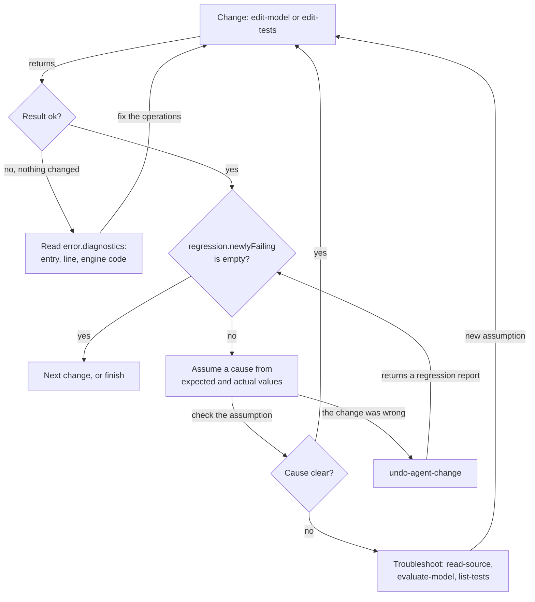
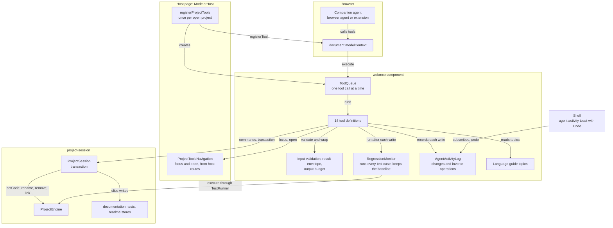
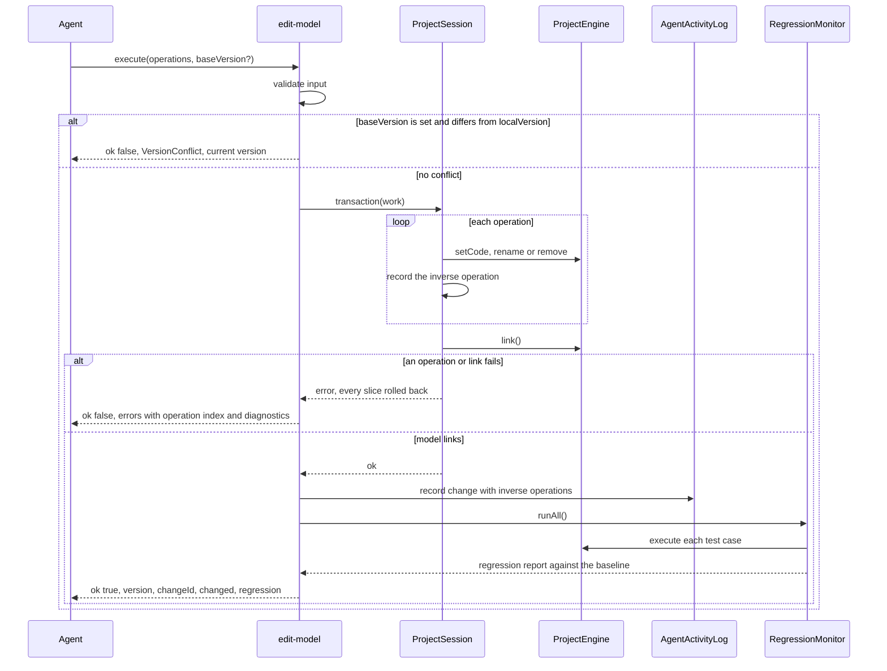
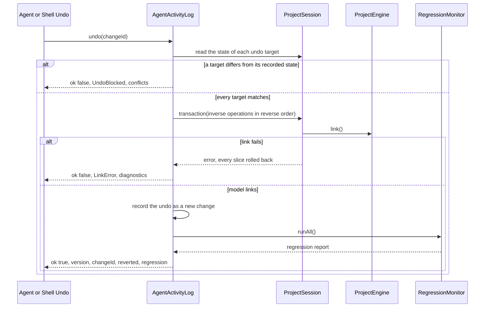
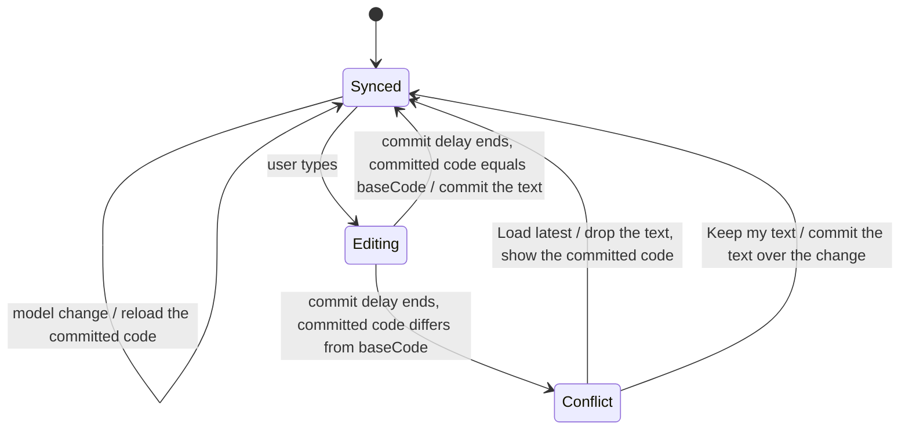

# WebMCP Companion Tools

## Summary

A companion LLM agent in the browser changes the project that is open in the Modeler. The page registers WebMCP tools
for the agent with `document.modelContext.registerTool`.

The contract is the [WebMCP draft](https://webmachinelearning.github.io/webmcp/) of the W3C Web Machine Learning CG, 10
November 2026.

The agent works in a change-and-react loop. Each change reports its outcome: link errors, or the failed test cases.

A failed test case comes with its expected and actual values. The agent reads the model only to troubleshoot.

Goals:

- **Outcome feedback:** each model or test write links the model and runs every test case of the project. The result
  names each problem exactly. The agent does not read the project back to verify a change.
- **One authority:** every tool goes through the open `ProjectSession`. The tools keep no copy of the model.
- **Safe changes:** a write is atomic. It changes the project only when the model still parses and links.
- **Cheap undo:** each write records the inverse of each operation. An undo replays the inverse operations and reports
  its outcome like any write.
- **Small context:** each tool does one task, has a short description, and returns compact JSON.
- **No backend:** the tools run in the page. They use no server, no network and no secret.

The new component `webmcp` (`edgerules-react/webmcp`) owns the tools. The host registers them once per open project.

## Technical Breakdown

### WebMCP platform contract

The tools use only the API of the draft. This table lists the parts that the component uses.

| Platform feature                      | Use in this story                                                                      |
| ------------------------------------- | -------------------------------------------------------------------------------------- |
| `document.modelContext`               | Entry point. `[SecureContext]`: only on HTTPS and `localhost`.                         |
| `registerTool(tool, {signal})`        | Registers one tool. Aborting `signal` unregisters it. There is no `unregisterTool`.    |
| `ModelContextTool.name`               | ASCII letters, digits, `_`, `-`, `.`; 1 to 128 characters. Duplicate names reject.     |
| `title`, `description`, `inputSchema` | Human label, agent-facing text, JSON Schema of the input object.                       |
| `outputSchema`                        | JSON Schema of the result object.                                                      |
| `execute(input, {signal})`            | Returns a `Promise`. The browser serializes the fulfilled value to a JSON string.      |
| `annotations.readOnlyHint`            | The tool only reads project state.                                                     |
| `annotations.untrustedContentHint`    | The result contains authored text, which can hold a prompt injection.                  |
| `annotations.consequentialHint`       | The agent or the browser asks the user to confirm before the call.                     |
| `exposedTo`                           | Not set. Only same-origin documents and the browser agent see the tools.               |
| Permissions Policy feature `tools`    | Default allowlist `'self'`. A host MAY set `Permissions-Policy: tools=()` to turn off. |
| `toolactivated`, `toolcancel` events  | The Shell shows the running tool.                                                      |
| `getTools()`, `executeTool()`         | Not used. E2E tests use Playwright `page.webmcp.tools()` and `callTool()`.             |

> Clarification: a rejected `execute` promise reaches the agent as `OperationError` without the message. So a tool never
> rejects for a domain error. It returns the error envelope (see [Result envelope](#result-envelope)).

Chrome ships the API behind `chrome://flags/#enable-webmcp-testing` (Chromium 146 or later) and an origin trial.

TypeScript DOM types do not declare the API. The component declares the structural type `ModelContextLike`.

### The agent works in a change-and-react loop

The tools support this loop. The read tools are for the troubleshooting branch only.



### Structural Diagram



### Behavioral Diagram

The `edit-model` tool changes the model in one session transaction and then runs every test case:



### Tool registration lifecycle

- The host calls `registerProjectTools` after it opens a `ProjectSession`. It calls `dispose` before it closes the
  session.
- `registerProjectTools` does nothing and returns an inactive handle when `modelContext` is `undefined`.
- The handle registers every tool with one `AbortController`. `dispose` aborts it, so every tool unregisters.
- `registerProjectTools` starts the first `RegressionMonitor.runAll()`. Its result is the first baseline.
- With `readOnly: true`, only the tools with `readOnlyHint` and `open-in-editor` register.
- `open-in-editor` registers only when `navigation` is set. `save-project` registers only when `allowSave` is `true`.
- `setReadOnly` and `setAllowSave` re-register the affected tools. The browser fires `toolchange`.
- The host MUST NOT register tools from editor components. One registration point exists per open project.
- `ToolQueue` runs one tool call at a time, in arrival order. A write and its regression run end before the next call
  starts.

```typescript
// edgerules-react/webmcp: public API

// The structural subset of the WebMCP `ModelContext` that the component uses.
interface ModelContextLike {
  registerTool(tool: ModelContextToolLike, options?: {signal?: AbortSignal}): Promise<void>; // rejects on bad name
}

interface ModelContextToolLike {
  name: string; // kebab-case, at most 30 characters
  title: string; // label for a confirmation dialog
  description: string; // at most 500 characters
  inputSchema: object; // JSON Schema draft 2020-12, `type: 'object'`
  outputSchema: object; // JSON Schema of `ToolResult<T>`
  annotations: {readOnlyHint?: boolean; untrustedContentHint?: boolean; consequentialHint?: boolean};
  execute(input: object, options: {signal: AbortSignal}): Promise<ToolResult<unknown>>; // never rejects for a domain error
}

// `document.modelContext` when the browser has it; `undefined` otherwise.
function getModelContext(doc?: Document): ModelContextLike | undefined;

interface ProjectToolsOptions {
  modelContext: ModelContextLike | undefined; // `getModelContext()`, or a polyfill of the host
  session: ProjectSession; // the open project
  navigation?: ProjectToolsNavigation; // enables `open-in-editor` and the `focus` of `get-project-overview`
  readOnly?: boolean; // registers only read tools; default false
  allowSave?: boolean; // registers `save-project`; default false
}

// Implemented by the host from its routes; the Shell path and view stay controlled by the host.
interface ProjectToolsNavigation {
  getFocus(): {path: string; view: ShellView}; // what the user looks at now
  open(path: string, view: ShellView): void; // the same navigation as a Project Explorer click
}

interface ProjectToolsHandle {
  readonly active: boolean; // false when `modelContext` is undefined
  readonly activity: AgentActivityLog; // every agent change of this registration
  setReadOnly(readOnly: boolean): void; // re-registers the write tools
  setAllowSave(allowSave: boolean): void; // registers or unregisters `save-project`
  dispose(): void; // unregisters every tool; the log keeps its entries
}

function registerProjectTools(options: ProjectToolsOptions): ProjectToolsHandle;
```

- [ ] Add the `webmcp` component with `index.ts`, `internal.ts`, a story and `__tests__/`
- [ ] Add the subpath export `edgerules-react/webmcp` to `package.json` and `tsdown.config.ts`
- [ ] Implement `getModelContext`, `registerProjectTools`, the handle and `ToolQueue`
- [ ] Register `ModelerHost` tools for the open project in `stories/support/modeler/ModelerHost.tsx`

### Tool design rules

Each tool follows these rules. The rules come from the Chrome WebMCP best practices and the draft security section.

| Rule              | Requirement                                                                                                          |
| ----------------- | -------------------------------------------------------------------------------------------------------------------- |
| Name              | `verb-noun` in kebab-case, at most 30 characters. The verb states the exact effect.                                  |
| Description       | At most 500 characters. It states what the tool does and when to use it. It does not repeat the schema.              |
| Parameter         | At most 30 characters in a name and 150 characters in a description. Names use the code terms of this repository.    |
| Schema            | Loose: types, enums and required members only. The code validates strictly and returns `InvalidInput`.               |
| Granularity       | One tool does one task. No two tools return the same data or make the same change.                                   |
| Flow control      | No description orders the agent to call tools in a sequence. A description MAY name the tool that supplies an input. |
| Feedback          | Each model or test write returns its outcome: diagnostics on failure, a regression report on success.                |
| Output size       | List and status results fit in 1,500 characters. Text results page with `offset`.                                    |
| Concurrency       | A write MAY take `baseVersion`. It then fails with `VersionConflict` when the project changed.                       |
| Atomicity         | Each write is one `ProjectSession.transaction`. It changes all or nothing.                                           |
| Reversibility     | Each write returns a `changeId`. `undo-agent-change` replays its inverse operations.                                 |
| Untrusted content | Each tool that returns authored text sets `untrustedContentHint`.                                                    |
| Scope             | The tools reach only the open project. No tool lists, opens, deletes or copies other projects.                       |
| Abort             | A tool checks `signal` before its commit point. After the commit point, it completes and returns the result.         |

### Result envelope

Every tool returns `ToolResult<T>`. The `outputSchema` of each tool describes it.

```typescript
type ToolResult<T> = ({ok: true} & T) | {ok: false; error: ToolError};

interface ToolError {
  code: ToolErrorCode; // the discriminant the agent switches on
  message: string; // one sentence, at most 300 characters
  path?: string; // the model path the error is about
  operation?: number; // the index of the failed operation in a batch
  diagnostics?: ModelDiagnostic[]; // parse and link problems, at most 20
  currentVersion?: number; // with `VersionConflict`
  conflicts?: SourcePath[]; // with `UndoBlocked`: the targets that changed after the agent change
  hint?: string; // the next useful step, for example "Call list-tests to see the input paths"
}

type ToolErrorCode =
  | 'InvalidInput' // the input fails validation; `message` names the member
  | 'NotFound' // the path, the test subject or the test case does not exist
  | 'VersionConflict' // the project changed after `baseVersion`
  | 'ParseError' // the DSL does not parse
  | 'LinkError' // the model does not link after the change
  | 'DuplicateName' // a set or rename collides with an existing entry
  | 'ExecutionError' // the engine failed to evaluate
  | 'SolverRequired' // the target calls an external function that has no resolver
  | 'UndoBlocked' // a target of the agent change changed later; `conflicts` names the targets
  | 'SaveConflict' // the repository has a newer revision
  | 'Aborted'; // the agent aborted the call before its commit point

interface ModelDiagnostic {
  source: 'parser' | 'linker';
  code?: string; // the engine code, for example `E101` or `UnexpectedToken`
  message: string;
  path?: string; // the entry that holds the problem
  line?: number; // 1-based, in the code of `path`
  column?: number; // 1-based
  excerpt?: string; // the source line, at most 120 characters
}
```

- A tool maps each `PortableError` to a `ToolError`. `EntryNotFound` maps to `NotFound`. `DuplicateName` maps to
  `DuplicateName`. `Parse`, `Linking` and `Execution` map to `ParseError`, `LinkError` and `ExecutionError`.
- A tool rejects only with `AbortError`, and only before its commit point.

- [ ] Implement `ToolResult`, `ToolError`, the `PortableError` mapping and the diagnostic line, column and excerpt
- [ ] Implement `fitOutput`: it trims arrays and text to the output budget and sets `truncated: true`

### Regression report

`RegressionMonitor` runs every authored test case of the project. It compares each run with the previous run, the
baseline.

Each model or test write, each undo and each `run-tests` call returns its report.

```typescript
interface RegressionReport {
  status: 'complete' | 'aborted'; // 'aborted': the agent aborted the call after the commit point
  passed: number; // passed cases in this run
  failed: number; // failed cases in this run
  newlyFailing: CaseFailure[]; // failed now; passed in the baseline or had no baseline result
  stillFailing: CaseRef[]; // failed in the baseline and now
  newlyPassing: CaseRef[]; // passed now; failed in the baseline
  truncated: boolean; // a list or a failure detail was trimmed to the output budget
}

interface CaseRef {
  subject: TestSubject;
  caseId: string;
  name: string;
}

interface CaseFailure extends CaseRef {
  runError?: string; // the case did not run: the `TestResultSet.error`, for example an `ExecutionError` message
  assertions: AssertionFailure[]; // at most 5 per case
}

interface AssertionFailure {
  path: string; // subject-relative, as in `list-tests`
  expected: string; // the authored assertion text
  actual?: string; // `formatValue` of the computed value; absent with `error` or `missing`
  error?: string; // the evaluation error of this path
  missing?: true; // the result has no value at this path
}
```

- `runAll` runs `createTestRunner(...).runAll()` for each test subject with cases, through `session.tests.forSubject`.
  So a mounted Tests view shows the same results.
- `runAll` builds `AssertionFailure` from the `TestResultSet` and the case assertions with `matches` and `formatValue`.
- The report lists `newlyFailing` in full first. It trims `stillFailing` and `newlyPassing` to fit 1,500 characters.
- A run of all subjects replaces the baseline. A run of one subject replaces the baseline entries of that subject.
- The baseline is the previous run, not the previous agent change. A user change between two runs also shows in it.

- [ ] Implement `RegressionMonitor` with `runAll`, `runSubject`, the baseline and `RegressionReport`
- [ ] Add `AssertionFailure` extraction next to `caseFailures` in `tests-manager`

### Shared input types

```typescript
// '*' for the whole model, or a dotted model path, for example 'applicant.age' or 'library.eligibility'.
type ModelPath = string;

// A model path, or the document path 'doc:README.md'. A model path never contains ':'.
type SourcePath = string;

// The Project Explorer sections that hold model entries.
type ModelSection = 'types' | 'factsLibrary' | 'methods' | 'decisions' | 'services' | 'variables' | 'workbooks';

// '*' for the tests of the whole model, otherwise the path of a callable (`TestSubjectId`).
type TestSubject = string;
```

Validation limits:

| Input                     | Limit                                                               |
| ------------------------- | ------------------------------------------------------------------- |
| `ModelPath`               | `*`, or segments that match `[A-Za-z_][A-Za-z0-9_]*`, joined by `.` |
| `SourcePath`              | A `ModelPath`, or `doc:README.md`                                   |
| `code` of one operation   | At most 50,000 characters                                           |
| `operations`, `items`     | 1 to 50 entries                                                     |
| Documentation `text`      | At most 20,000 characters                                           |
| Test value text           | At most 2,000 characters                                            |
| `limit` of a list         | 1 to 200; default 100                                               |
| `query` of `search-model` | 1 to 200 characters                                                 |

### Tool catalog

| #   | Tool                   | Kind     | `readOnlyHint` | `untrustedContentHint` | `consequentialHint` | Registered when                |
| --- | ---------------------- | -------- | -------------- | ---------------------- | ------------------- | ------------------------------ |
| 1   | `edit-model`           | Change   | false          | false                  | false               | Not `readOnly`                 |
| 2   | `edit-tests`           | Change   | false          | false                  | false               | Not `readOnly`                 |
| 3   | `set-documentation`    | Change   | false          | false                  | false               | Not `readOnly`                 |
| 4   | `undo-agent-change`    | Change   | false          | false                  | false               | Not `readOnly`                 |
| 5   | `run-tests`            | Feedback | true           | false                  | false               | Always                         |
| 6   | `get-project-overview` | Orient   | true           | true                   | false               | Always                         |
| 7   | `get-language-guide`   | Orient   | true           | false                  | false               | Always                         |
| 8   | `list-model-entries`   | Inspect  | true           | true                   | false               | Always                         |
| 9   | `read-source`          | Inspect  | true           | true                   | false               | Always                         |
| 10  | `search-model`         | Inspect  | true           | true                   | false               | Always                         |
| 11  | `list-tests`           | Inspect  | true           | true                   | false               | Always                         |
| 12  | `evaluate-model`       | Inspect  | true           | false                  | false               | Always                         |
| 13  | `open-in-editor`       | UI       | false          | false                  | false               | `navigation` is set            |
| 14  | `save-project`         | Persist  | false          | false                  | true                | Not `readOnly` and `allowSave` |

- **Change:** the daily tools. Each one returns its outcome.
- **Feedback:** an explicit regression run, for example after the user says they changed something.
- **Orient:** the first calls of a session.
- **Inspect:** the troubleshooting branch of the loop.

> Clarification: `run-tests` writes the in-memory test results that the Tests view shows. Results are derived data and
> are never saved, so the tool counts as read-only. A change tool is not consequential, because `undo-agent-change`
> reverts it and nothing persists before `save-project`.

The `text` block of each tool is its exact `description` string. Each one is at most 500 characters.

#### 1. `edit-model`

```text
Changes the EdgeRules model in one atomic step: set the DSL of an entry (creates it when new), rename or remove. If
the model does not parse or link after the last operation, nothing changes and the exact errors return. Otherwise
every test case of the project runs, and the result lists the cases that now fail with expected and actual values.
You do not need to read the model back to check the change.
```

```typescript
interface EditModelInput {
  operations: ModelOperation[];
  baseVersion?: number; // `version` from a previous result; omit to apply on the current state
}

type ModelOperation =
  // One declaration or one field. `engine.setCode(path, code)`.
  | {op: 'set'; path: ModelPath; code: string}
  // `session.execute({type: 'renamePath', path, newName})`. `newName` is one segment.
  | {op: 'rename'; path: ModelPath; newName: string}
  // `engine.remove(path)`. Also removes the documentation of the path and of each nested path.
  | {op: 'remove'; path: ModelPath};

interface ChangeResult {
  version: number; // `localVersion` after the change
  changeId: string;
  changed: ModelPath[]; // the target paths, and each path whose references a rename rewrote
  regression: RegressionReport;
}
```

- `path: '*'` is `InvalidInput` for every operation. Set each top-level entry with its own operation.
- The tool runs all operations in one `session.transaction` and calls `engine.link()` at the end. A throw rolls back.
- A failed operation returns its index in `error.operation`. A link failure returns up to 20 `diagnostics`.
- `changed` of a rename comes from the rewritten paths that the engine returns. See
  [Engine prerequisite](#engine-prerequisite).

#### 2. `edit-tests`

```text
Adds, changes or removes test cases of one test subject in one atomic step. Values are EdgeRules literal text, keyed
by paths relative to the subject; inputs feed the run and assertions are the expected results. An empty value text
removes that value. After the change every test case of the project runs, and the result lists the cases that now
fail with expected and actual values.
```

```typescript
interface EditTestsInput {
  subject: TestSubject;
  operations: TestOperation[];
  baseVersion?: number;
}

type TestOperation =
  | {op: 'add'; name: string; inputs?: TestValuesByPath; assertions?: TestValuesByPath}
  // Merges `inputs` and `assertions` into the case; a member with '' removes that value.
  | {op: 'update'; caseId: string; name?: string; inputs?: TestValuesByPath; assertions?: TestValuesByPath}
  | {op: 'remove'; caseId: string};

interface TestsChangeResult extends ChangeResult {
  addedCaseIds: string[]; // in the order of the `add` operations
}
```

- The tool calls `syncRows(deriveRows(...))` before it writes, so the paths exist without a mounted Tests view.
- A path that is not a present row fails with `InvalidInput`. `hint` names `list-tests`.
- An input path MUST be an `inputs` row. An assertion path MUST be an `assertions` or `validations` row.

#### 3. `set-documentation`

```text
Sets the documentation of model entries or the project README. Each item replaces the whole Markdown text of one
path; an empty text removes the documentation of a model entry. The editors show the documentation next to its
entry. Documentation does not change test results, so no tests run.
```

```typescript
interface SetDocumentationInput {
  items: {path: SourcePath; text: string}[]; // 'doc:README.md' sets the README; it MUST NOT be empty
  baseVersion?: number;
}

interface DocumentationChangeResult {
  version: number;
  changeId: string;
}
```

- A model path that does not exist fails with `NotFound`. Nothing changes.
- The tool writes in one `session.transaction` through `session.documentation` and `session.readme`.

#### 4. `undo-agent-change`

```text
Reverts one change that a tool of this page made, with its changeId, by its inverse operations. The undo is a new
change: it has its own changeId, and the result reports link errors and the regression like edit-model. It fails
when the user or another agent change edited a target of that change later.
```

```typescript
interface UndoAgentChangeInput {
  changeId: string;
}

interface UndoResult extends ChangeResult {
  reverted: string; // the `changeId` of the reverted change
}
```

- The tool calls `AgentActivityLog.undo`. See [Agent activity and undo](#agent-activity-and-undo).

#### 5. `run-tests`

```text
Runs the authored test cases of one test subject, or of every subject, and returns the regression report: the cases
that fail with expected and actual values, and what changed since the previous run. Change tools run every test
already; use this tool after the user says they changed something.
```

```typescript
interface RunTestsInput {
  subject?: TestSubject; // default: every subject with test cases
}

interface RunTestsResult {
  regression: RegressionReport;
}
```

- The tool checks `signal` between test cases. An aborted run returns `status: 'aborted'` and keeps the baseline.

#### 6. `get-project-overview`

```text
Returns the state of the EdgeRules project open in this page: project and model name, save state, DSL validity, the
number of entries per section, the test totals of the last run, the entry the user is looking at, and the current
version. Call it at the start of a session.
```

```typescript
interface GetProjectOverviewInput {} // no members

interface ProjectOverview {
  project: {name: string; description?: string; origin?: string}; // `origin` as `<id>@<version>`
  model: {name?: string; version?: string}; // `ModelMetadata`
  version: number; // `ProjectSessionSnapshot.localVersion`
  phase: ProjectSessionPhase;
  unsavedSlices: ProjectSlice[]; // `dirtySlices`; empty when everything is saved
  savedAt?: string; // ISO time of the last save
  dslValid: boolean; // false when the last `commitDsl` failed
  dslError?: string; // the message of `DslValidity` when `dslValid` is false
  draftPending: boolean; // `hasDslDraft`: the user has uncommitted DSL in the Code view; writes still apply
  counts: Record<ModelSection, number> & {testSubjects: number; testCases: number};
  tests: {passed: number; failed: number; ranAt?: number}; // the last regression run; `ranAt` in epoch ms
  focus?: {path: SourcePath; view: ShellView}; // only with `navigation`
  readOnly: boolean;
  canSave: boolean; // `save-project` is registered
}
```

#### 7. `get-language-guide`

```text
Returns the EdgeRules language reference for one topic, with valid examples and their outputs. Without a section, it
returns the introduction of the topic and its section titles. Read the introduction topic before you write EdgeRules
code for the first time, and the topic of each construct you use.
```

```typescript
// One topic for each Markdown file of `../edgerules/docs/reference/`.
type GuideTopic =
  | 'introduction' // base-examples.md: literals, operators, lists, filters, ranges, contexts, dates, special values
  | 'user-functions' // user-functions-reference.md
  | 'user-types' // user-types-reference.md
  | 'rulesets' // rulesets-reference.md
  | 'loops' // loop-reference.md
  | 'optimise' // optimise-reference.md
  | 'optimise-examples' // optimise-examples.md
  | 'decision-layers' // decision-layers-reference.md: `facts`, `decision`, `service`
  | 'annotations' // annotations-story.md
  | 'explain' // explain-reference.md
  | 'dates' // dates-reference.md
  | 'list-functions' // list-functions-reference.md
  | 'string-functions' // string-functions-reference.md
  | 'numeric-functions' // numeric-functions-reference.md
  | 'finance-functions' // finance-functions-reference.md
  | 'example-model'; // playground.md: a complete loan origination model

interface GetLanguageGuideInput {
  topic: GuideTopic;
  section?: string; // a `##` heading title from `sections`; omit for the introduction of the topic
  offset?: number; // from `nextOffset` of the previous page
}

interface GuidePage {
  topic: GuideTopic;
  section?: string;
  text: string; // Markdown: without `section`, the text before the first `##` heading
  sections: string[]; // every `##` heading title of the topic
  nextOffset?: number; // present when the text continues; a page has at most 6,000 characters
}
```

- The guide text is a copy of `../edgerules/docs/reference/`. The engine repository owns it.
- `scripts/sync-language-guide.mjs` copies the topic files to `src/components/webmcp/guide/reference/`. It also writes
  `guide-source.json` with the commit of `../edgerules` and the file list. The copy is checked in, so CI does not need
  the sibling repository.
- The component imports each file with `?raw`. The engine CI backtests every example of the reference.
- `_reference.md` (authoring rules) and `optimise-solver-hosting.md` (host wiring, not DSL) are not topics.
- An unknown `section` fails with `NotFound`. `hint` lists the section titles.

#### 8. `list-model-entries`

```text
Lists the entries of the EdgeRules model as a flat outline: path, kind, signature or type, the first line of the
documentation and the number of test cases. Use it to find the path of an entry, for example before a change to an
entry you have not seen. Filter by Project Explorer section or list only the entries below one context.
```

```typescript
interface ListModelEntriesInput {
  sections?: ModelSection[]; // default: every section
  under?: ModelPath; // only entries at or below this context; default '*'
  offset?: number; // from `nextOffset` of the previous page
  limit?: number;
}

interface ModelEntriesPage {
  entries: OutlineEntry[]; // in Project Explorer order: section, then name
  total: number;
  nextOffset?: number; // present when more entries exist
}

interface OutlineEntry {
  path: ModelPath;
  section: ModelSection;
  kind: ExplorerEntryKind; // the Project Explorer kind, for example 'function' or 'ruleset'
  signature?: string; // a callable: '(amount: number, rate: number): number'; a field or type: its type
  doc?: string; // the first line of the documentation, at most 120 characters
  testCases?: number; // only when the entry is a test subject with cases
}
```

- [ ] Build the outline from `buildSections` of `project-explorer/internal.ts` and `get('*', kinds)` interface kinds

#### 9. `read-source`

```text
Returns the source text of one project element: EdgeRules DSL for a model path, the whole model for '*', or Markdown
for doc:README.md. A model path also returns its documentation. Long text comes in pages; continue with nextOffset.
Use it to troubleshoot, or before you change an entry you have not seen.
```

```typescript
interface ReadSourceInput {
  path: SourcePath;
  offset?: number; // character offset; default 0
}

interface SourcePage {
  path: SourcePath;
  language: 'edgerules' | 'markdown';
  text: string; // `engine.getCode(path)` or the README Markdown, from `offset`; at most 4,000 characters
  offset: number;
  totalChars: number;
  nextOffset?: number;
  documentation?: string; // the description of a model path, when one exists
}
```

- A page ends at a line break when one exists in the last 20% of the page.
- The text is the committed model, also while `draftPending` is true.

#### 10. `search-model`

```text
Finds text in the model DSL, entry names and documentation, without regard to case. Returns the path of each
matching entry with a short excerpt and line. Use it to find where a name occurs. It matches text, so a result can
be a comment or a string.
```

```typescript
interface SearchModelInput {
  query: string;
  scope?: ('code' | 'names' | 'documentation')[]; // default: all three
  limit?: number;
}

interface SearchResult {
  matches: {path: ModelPath; scope: 'code' | 'names' | 'documentation'; line?: number; excerpt: string}[];
  truncated: boolean; // more matches exist than `limit`
}
```

- The tool searches the `getCode` text of each top-level declaration. An excerpt has at most 120 characters.

#### 11. `list-tests`

```text
Returns the authored test cases of one test subject, the whole model ('*') or a callable path. Each case has its id,
name, input values and assertion values, keyed by paths relative to the subject. Also returns the paths that cases
can use. Use it before edit-tests on a subject you have not seen.
```

```typescript
interface ListTestsInput {
  subject: TestSubject;
}

interface TestSuiteView {
  subject: TestSubject;
  paths: {path: string; section: TestSectionId; type?: string}[]; // the present rows; '' for a scalar result
  cases: {
    id: string;
    name: string;
    inputs: TestValuesByPath; // raw EdgeRules literal text
    assertions: TestValuesByPath;
  }[];
}
```

- The tool derives the rows with `deriveRows` and `listTestSubjects` of `tests-manager/internal.ts`. A subject with no
  stored suite returns its derived paths and no cases.

#### 12. `evaluate-model`

```text
Runs the whole model, or one function, decision or service, with an input object and returns the result value.
Nothing in the project changes. Use it to probe an assumption with one concrete case.
```

```typescript
interface EvaluateModelInput {
  target: ModelPath; // '*' evaluates the whole model
  input?: Record<string, unknown>; // the parameters of a callable, or the placeholder values of the model
}

interface EvaluationResult {
  result: unknown; // the value of `engine.execute(target, input)`
  truncated: boolean; // the JSON of `result` exceeded 6,000 characters and was trimmed
}
```

- The tool fails with `SolverRequired` when `engine.requiresSolver()` is true and no `solverHandler` is set.

#### 13. `open-in-editor`

```text
Shows one project element to the user in the Modeler: a model entry or the README, in the code, boxed, flow, tests
or preview view. Use it to show the user the result of a change or the entry that an answer is about.
```

```typescript
interface OpenInEditorInput {
  path: SourcePath;
  view?: ShellView; // default: the default view of the entry kind
}

interface OpenResult {
  path: SourcePath;
  view: ShellView;
}
```

- A view that the Shell does not offer for the path fails with `InvalidInput`. `hint` lists the views of the path.
- The tool calls `navigation.open(path, view)`. The host updates its route as for a Project Explorer click.

#### 14. `save-project`

```text
Saves the open project as a new revision in the workspace of the user. Changes stay only in this page until a save.
Use it when the user asks to save.
```

```typescript
interface SaveProjectInput {
  baseVersion?: number;
}

interface SaveResultView {
  revision: string;
  savedAt: string;
}
```

- The tool fails with `ParseError` while `dslValid` is false. It fails with `SaveConflict` on a repository conflict.
- `consequentialHint: true` makes the browser or agent ask the user before each call.

- [ ] Implement tools 1 to 5 with tests against a real `@edgerules/node` session
- [ ] Implement tools 6 to 12 with tests against a real `@edgerules/node` session
- [ ] Implement tools 13 and 14 with tests
- [ ] Add a test that checks each name, description and parameter description against the length limits

### Engine prerequisite

The engine `rename(path, newName)` returns the paths whose code it rewrote. `edit-model` reports them in `changed`.

```typescript
interface EngineService {
  rename(path: string, newName: string): string[] | PortableError; // the paths whose references the rename rewrote
}
```

- `ProjectSession.execute({type: 'renamePath', ...})` returns `{ok: true; rewritten: string[]}`.
- [x] File the feature request: [rimvydasb/edgerules#68](https://github.com/rimvydasb/edgerules/issues/68)
- [ ] Update `EngineService`, `renamePath` and `CommandResult` when the engine ships it

### Agent activity and undo

`AgentActivityLog` records each agent change as its operations and their inverse operations. An undo replays the inverse
operations in reverse order, in one transaction.

| Operation                  | Recorded at apply time                                  | Inverse operation                                   | Undo target        |
| -------------------------- | ------------------------------------------------------- | --------------------------------------------------- | ------------------ |
| `set` of an existing entry | `getCode(path)` before and after                        | `set` with the code before                          | `path`             |
| `set` of a new entry       | `getCode(path)` after                                   | `remove`                                            | `path`             |
| `rename`                   | The old path, the new path and `getCode` of the new one | `rename` of the new path back to the old name       | The new path       |
| `remove`                   | `getCode(path)` and the removed documentation entries   | `set` with the removed code, then the documentation | The absent `path`  |
| `set-documentation` item   | The text before and after                               | The text before                                     | The documentation  |
| `edit-tests` `add`         | The new case                                            | `remove` of the case                                | The case           |
| `edit-tests` `update`      | The case before and after                               | `update` with the values before                     | The case           |
| `edit-tests` `remove`      | The removed `TestCase`                                  | `restoreTestCase` with the same id and order        | The absent case id |

- Each inverse operation checks only its undo target: the current state MUST equal the recorded state after the change.
  A difference fails the undo with `UndoBlocked` and names the target in `conflicts`.
- The engine moves the references back on the inverse rename. The undo does not check the rewritten paths.
- An undo is an agent change with its own `changeId` and inverse operations. So an undo of an undo is a redo.
- Removed tests of a removed callable stay in the tests slice as absent rows. The inverse `set` makes them present.

The undo of one agent change follows this sequence:



```typescript
interface AgentChange {
  changeId: string; // `ac-<n>`, unique within the log
  tool: 'edit-model' | 'edit-tests' | 'set-documentation' | 'undo-agent-change';
  summary: string; // for example "Set risk.score, renamed limit to maxLimit"
  targets: SourcePath[]; // the undo targets; a test case as `<subject>#<caseId>`
  at: number; // epoch ms
  reverts?: string; // the `changeId` that this undo reverted
  regression?: {passed: number; failed: number; newlyFailing: number}; // the totals of its regression run
}

interface AgentActivityLog {
  list(): readonly AgentChange[]; // newest first; at most 50 changes
  canUndo(changeId: string): boolean; // every undo target matches its recorded state
  undo(changeId: string): Promise<ToolResult<UndoResult>>; // the logic of `undo-agent-change`
  subscribe(listener: () => void): Unsubscribe;
}
```

- The Shell gets the new prop `agentActivity?: AgentActivityLog`.
- After each new agent change, the Shell shows a toast with `src/ui/Toast.tsx`. It shows the summary, the regression
  totals, "Undo" and "Show".
- The toast shows "Undo" only while `canUndo` is true. "Show" opens the first target in its default view.
- The Shell shows a "Companion is working" indicator from `toolactivated` until the tool returns or `toolcancel` fires.

- [ ] Implement `AgentActivityLog` with inverse operations, target checks and a limit of 50 changes
- [ ] Add `restoreTestCase(testCase: TestCase): void` to `TestCasesService`
- [ ] Add the `agentActivity` prop, the toast and the working indicator to the Shell

### Agent writes and Code view drafts

Agent writes never wait for the user and never fail because of uncommitted Code view text. The Code view
(`src/components/shell/views/CodeView.tsx`) prevents a lost change instead.

- The Code view keeps `baseCode`: the committed code of its root when it loaded or last committed its text.
- For the root `*`, `baseCode` is the whole model. So each model change makes a pending commit a conflict.
- For an entry root, only a change of that entry makes a pending commit a conflict.
- The session keeps its DSL draft after an agent write. `get-project-overview` reports it as `draftPending`.

The Code view text moves through these states:



- In `Conflict`, the Code view shows a bar with the text `The model changed while you edited.`
- The bar has two actions: "Load latest" and "Keep my text".
- In `Conflict`, the Code view does not commit on its timer or on unmount. The text stays in the `drafts` map.
- "Keep my text" changes an undo target of the agent change. So an undo of that change fails with `UndoBlocked`.

- [ ] Add `baseCode`, the conflict state and the conflict bar to `CodeView.tsx`
- [ ] Reload the text of a `Synced` Code view on each model change

### Security

| Threat                                   | Control                                                                                                     |
| ---------------------------------------- | ----------------------------------------------------------------------------------------------------------- |
| Prompt injection in model text or README | `untrustedContentHint` on each tool that returns authored text. Projects come from examples or other users. |
| Cross-origin actuation                   | No `exposedTo`. The `tools` Permissions Policy keeps the default `'self'`.                                  |
| Silent destructive change                | Atomic writes, a toast for each change, one-click undo. Nothing persists without `save-project`.            |
| Silent persistence                       | `save-project` is off by default and has `consequentialHint`.                                               |
| Lost user edit                           | Undo target checks. The Code view shows a conflict bar and does not overwrite silently.                     |
| Large or malformed input                 | Strict validation and the limits table. Errors return `InvalidInput` and change nothing.                    |
| Data exfiltration                        | No tool makes a network request, reads another project or reads browser storage outside the session.        |
| Over-parameterization                    | No tool takes personal data. Every parameter addresses project content.                                     |

## Architecture Changes

- New component `webmcp`, subpath export `edgerules-react/webmcp`. Allowlist: `project-session`, `project-explorer`,
  `test-cases-service`, `tests-manager`.
- `shell` allowlist adds `webmcp` (the `AgentActivityLog` type).
- `project-explorer/internal.ts` already exports `buildSections`.
- `tests-manager/internal.ts` (new) exports `deriveRows`, `listTestSubjects`, `createTestRunner`, `caseFailures`,
  `matches` and `formatValue`.
- `TestCasesService` gets `restoreTestCase`.
- `ProjectSession.execute` returns the rewritten paths of `renamePath`.
- `docs/architecture-adr.md` gets an ADR: a change tool returns its outcome (diagnostics or a regression report). The
  agent does not read the project back to verify a change.
- `docs/architecture-adr.md` gets an ADR: tools return an error envelope and do not reject for domain errors.
- `docs/architecture-adr.md` gets an ADR: one atomic `edit-model` with operations, not one tool per operation.
- `docs/architecture-adr.md` gets an ADR: an undo replays recorded inverse operations. It does not compare project
  snapshots.

## Out of Scope

- Workspace tools: list, open, create, copy or delete projects.
- Flow canvas layout: node positions, output nodes and chart nodes.
- Model metadata (`setModelMetadata`).
- The declarative WebMCP form API.
- A built-in chat panel. The agent is the browser agent or an extension.
- A WebMCP polyfill. A host MAY pass one as `modelContext`.

## Limitations

- Each model or test change runs every test case of the project. Its duration grows with the number of test cases.
- `newlyFailing` compares with the previous run. A user change between two runs also shows in it.
- The undo checks only its undo targets. A user edit of a reference that a rename rewrote is not checked.
- `search-model` matches text. The engine has no reference index, so a match in a comment or string is also a result.
- The Code view conflict bar shows no diff.
- The language guide is a copy. A change of `../edgerules/docs/reference/` needs a new sync run.
- Chrome recommends 1,500 characters per output. `read-source` pages have 4,000 characters, because a DSL declaration is
  often longer than 1,500.
- A tool works only while the project is open in the page.

## Future Improvements

- Run only the test cases that depend on the changed paths, when the engine exposes dependencies.
- A `find-references` tool when the engine exposes a reference index.
- A `get-builtin` tool when the engine ships the builtins catalog.
- Flow layout tools for workbooks.
- Evaluation with real LLM agents over the scenario set of Phase 5.

## Verification

| Check        | Command                |
| ------------ | ---------------------- |
| Build        | `npm run build`        |
| Typecheck    | `npm run typecheck`    |
| Lint         | `npm run lint`         |
| Format       | `npm run format:check` |
| Dependencies | `npm run depcruise`    |
| Test         | `npm test`             |
| E2E          | `npm run e2e`          |
| Storybook    | `npm run storybook`    |
| Start        | `npm run dev`          |

## Tasks

**Phase 1: foundation, regression monitor and feedback**

- [ ] Ensure project compiles and existing tests are passing
- [ ] Add the `webmcp` component, subpath export and dependency-cruiser allowlist
- [ ] Implement `ModelContextLike`, `getModelContext`, `registerProjectTools`, the handle and `ToolQueue`
- [ ] Implement `ToolResult`, the `PortableError` mapping, input validation and `fitOutput`
- [ ] Add `tests-manager/internal.ts` and the `AssertionFailure` extraction
- [ ] Implement `RegressionMonitor` and `run-tests`
- [ ] Add tests for the code of this phase, with a real `@edgerules/node` session and a recording `ModelContextLike`

Acceptance criteria:

- [ ] `npm test` passes, including `registerProjectTools.test.ts` and `regressionMonitor.test.ts`
- [ ] `regressionMonitor.test.ts` shows `newlyFailing` with `expected` and `actual` after a model change breaks a case
- [ ] `regressionMonitor.test.ts` shows `newlyPassing` after the fix, and `stillFailing` for an unrelated failing case
- [ ] `registerProjectTools.test.ts` shows that `dispose` aborts the signal of every tool
- [ ] `toolQueue.test.ts` shows that a second call starts after the first call and its regression run end
- [ ] `npm run depcruise` passes

**Phase 2: change tools and undo**

- [ ] Add `restoreTestCase` to `TestCasesService`
- [ ] Implement `edit-model`, `edit-tests`, `set-documentation` and their regression runs
- [ ] Implement `AgentActivityLog` and `undo-agent-change` with inverse operations
- [x] File the engine feature request for the rewritten paths of `rename` (rimvydasb/edgerules#68)
- [ ] Add tests for the code of this phase

Acceptance criteria:

- [ ] `npm test` passes, including `editModel.test.ts`, `editTests.test.ts` and `undoAgentChange.test.ts`
- [ ] `editModel.test.ts` shows that a batch with a link error leaves the DSL and every slice unchanged
- [ ] `editModel.test.ts` shows that a successful change returns a regression report of every subject
- [ ] `editModel.test.ts` shows `VersionConflict` for a stale `baseVersion` and success without `baseVersion`
- [ ] `editModel.test.ts` shows that a write with a DSL draft succeeds and keeps the draft
- [ ] `undoAgentChange.test.ts` shows that undo of `set`, `rename` and `remove` restores the code, references and
      documentation
- [ ] `undoAgentChange.test.ts` shows `UndoBlocked` with `conflicts` after a user edit of the same entry
- [ ] `undoAgentChange.test.ts` shows a successful undo after a user edit of another entry
- [ ] `undoAgentChange.test.ts` shows that an undo of an undo restores the change
- [ ] `editTests.test.ts` shows that the undo of a case removal restores the case id and order

**Phase 3: orient and inspect tools**

- [ ] Add `scripts/sync-language-guide.mjs` and run it to copy `../edgerules/docs/reference/`
- [ ] Implement `get-project-overview` and `get-language-guide`
- [ ] Implement `list-model-entries`, `read-source`, `search-model`, `list-tests` and `evaluate-model`
- [ ] Add tests for the code of this phase

Acceptance criteria:

- [ ] `npm test` passes, including `orientTools.test.ts`, `inspectTools.test.ts` and `languageGuide.test.ts`
- [ ] `languageGuide.test.ts` loads every topic, lists its sections, and pages a section longer than 6,000 characters
- [ ] `node scripts/sync-language-guide.mjs` copies the reference and leaves `git status` clean on a second run
- [ ] `toolMetadata.test.ts` checks the name, description and parameter limits of every registered tool

**Phase 4: host and Shell integration**

- [ ] Implement `open-in-editor` and `save-project`
- [ ] Add the `agentActivity` prop, the toast and the working indicator to the Shell
- [ ] Add the Code view conflict state and bar
- [ ] Register the tools in `ModelerHost` with a `ProjectToolsNavigation` from the routes
- [ ] Add the Storybook story `WebMCP/Tool inspector`: it lists the tools and runs one with a JSON input
- [ ] Add tests for the code of this phase

Acceptance criteria:

- [ ] `npm test` passes, including `Shell.agentActivity.test.tsx`, `CodeView.conflict.test.tsx` and `hostTools.test.ts`
- [ ] `CodeView.conflict.test.tsx` shows that an agent change of the edited entry stops the timer commit and shows the
      bar
- [ ] In `npm run storybook`, the tool inspector runs `edit-model`, the toast shows the regression totals, and "Undo"
      reverts the change
- [ ] With `readOnly: true`, the tool inspector lists only the read tools and `open-in-editor`

**Phase 5: agent scenarios**

- [ ] Add scenario fixtures in `src/components/webmcp/__tests__/scenarios/`: a task, the tool calls and the expected
      regression reports
- [ ] Cover these change-and-react scenarios:
  - [ ] Change a ruleset row, get one newly failing case, fix the row, get it newly passing
  - [ ] Add a function and its test cases, get every case passing
  - [ ] Rename a callable that a ruleset uses, get `changed` with the rewritten paths and no newly failing case
  - [ ] Send a change with a link error, get the diagnostics, send the fixed change
  - [ ] Undo a wrong change, get the failing cases newly passing
- [ ] Replay each fixture through `execute` of the registered tools and compare each regression report

Acceptance criteria:

- [ ] `npm test` passes, including `scenarios.test.ts`

**Phase E2E:**

- [ ] Add the Playwright project `webmcp` to `playwright.config.ts`: Chromium with
      `launchOptions.args: ['--enable-features=WebMCP']` and `testMatch: 'webmcp/**'`
- [ ] Add `e2e/webmcp/webmcp.spec.ts`. It opens a Storybook Modeler project and uses `page.webmcp.tools()` and
      `page.webmcp.callTool()` of Playwright 1.64
- [ ] Cover these flows:
  - [ ] `tools()` lists every registered tool with its annotations
  - [ ] `callTool('edit-model')` breaks a test case, and the result has the case in `newlyFailing`
  - [ ] The Tests view shows the failure, and the toast shows the regression totals
  - [ ] "Undo" in the toast reverts the change, and the Tests view shows the case passing
  - [ ] `callTool('edit-model')` on the entry open in the Code view with typed text shows the conflict bar
  - [ ] A read-only project lists only the read tools and `open-in-editor`

Acceptance criteria:

- [ ] `npm run e2e` passes, including `webmcp.spec.ts`

**Phase X:**

- [ ] Update `docs/architecture.md` with the changes from `## Architecture Changes`
- [ ] Add the four ADR entries to `docs/architecture-adr.md`
- [ ] Add the `webmcp` component to `README.md`
- [ ] Review the implementation against this story and the project conventions

Acceptance criteria:

- [ ] Every command in `## Verification` passes
- [ ] The application starts with `npm run dev`, and Chrome with `#enable-webmcp-testing` lists the tools
