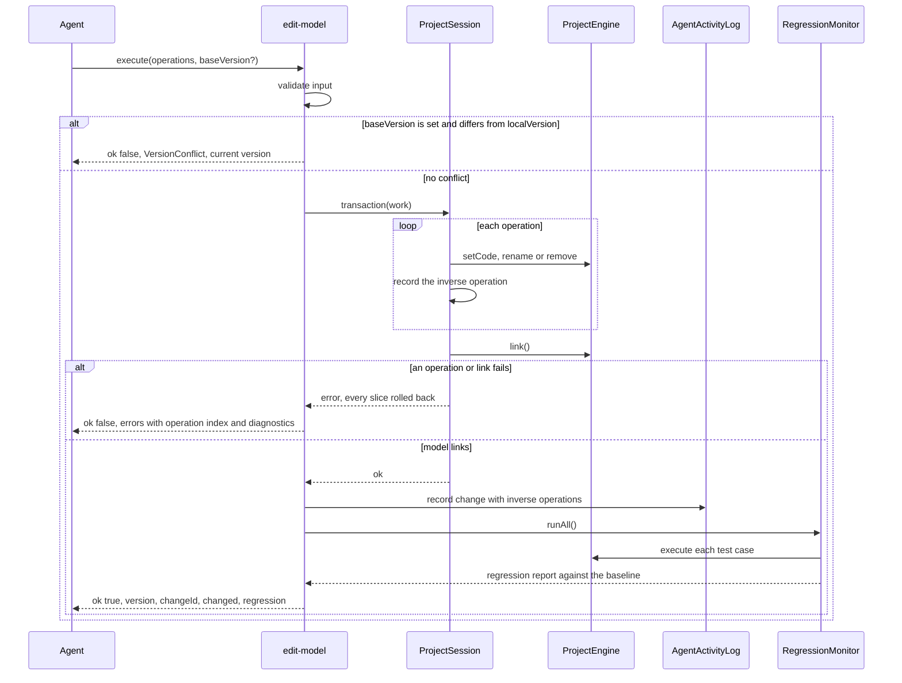
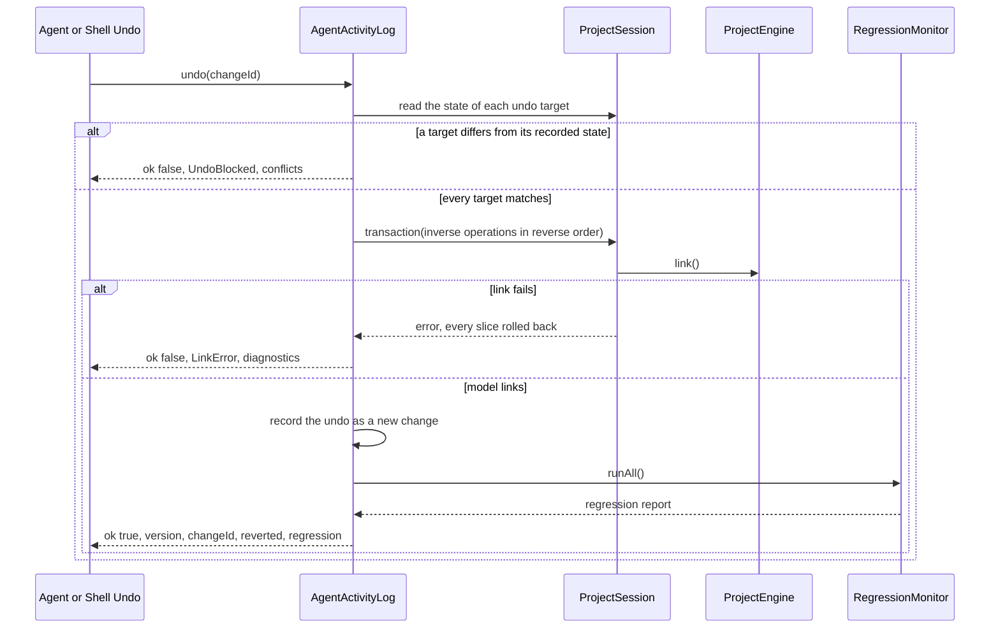

# WebMCP Phase 2: change tools and undo

This phase adds the four change tools. Each change returns its outcome, and each change can be undone.

| Attribute         | Value                                                                                           |
| ----------------- | ----------------------------------------------------------------------------------------------- |
| Story             | [webmcp-story.md](../webmcp-story.md)                                                           |
| Recommended model | Opus. Transactions, inverse operations and undo target checks need exact reasoning about state. |
| Depends on        | Phase 1                                                                                         |

Read these sections of the main story before you start. Do not read the other phase files.

- [Component architecture](../webmcp-story.md#component-architecture)
- [Component folder layout](../webmcp-story.md#component-folder-layout)
- [Tool design rules](../webmcp-story.md#tool-design-rules)
- [Result envelope](../webmcp-story.md#result-envelope)
- [Shared input types](../webmcp-story.md#shared-input-types)
- [Tool catalog](../webmcp-story.md#tool-catalog)

## Technical Breakdown

`RegressionReport` and `RegressionMonitor` exist from Phase 1 in `project/regression/`.

### `edit-model` sequence

The `edit-model` tool changes the model in one session transaction and then runs every test case:



### Change service contracts

```typescript
// project/changes/projectChangeService.ts: apply, record the inverse operations, run the regression.
interface ProjectChangeService {
  editModel(input: EditModelInput, signal: AbortSignal): Promise<ToolResult<ChangeResult>>;
  editTests(input: EditTestsInput, signal: AbortSignal): Promise<ToolResult<TestsChangeResult>>;
  setDocumentation(input: SetDocumentationInput): ToolResult<DocumentationChangeResult>;
  undo(changeId: string, signal: AbortSignal): Promise<ToolResult<UndoResult>>;
  readonly activity: AgentActivityLog;
}

// project/changes/operations/*.ts: one applier for each operation family.
interface OperationApplier<Op> {
  apply(operation: Op): AppliedOperation; // runs inside the transaction of `ProjectChangeService`; throws to roll back
}

interface AppliedOperation {
  target: SourcePath; // the undo target; a test case as `<subject>#<caseId>`
  stateAfter: unknown; // the target state that a later undo compares with
  inverse: () => AppliedOperation; // applies the inverse operation and returns its own record
  changed: SourcePath[]; // the target, and the paths that a rename rewrote
}
```

### 1. `edit-model`

```text
Changes the EdgeRules model in one atomic step: set the DSL of an entry (creates it when new), rename or remove. If
the model does not parse or link after the last operation, nothing changes and the exact errors return. Otherwise
every test case of the project runs, and the result lists the cases that now fail with expected and actual values.
You do not need to read the model back to check the change.
```

```typescript
interface EditModelInput {
  operations: ModelOperation[];
  baseVersion?: number; // `version` from a previous result; omit to apply on the current state
}

type ModelOperation =
  // One declaration or one field. `engine.setCode(path, code)`.
  | {op: 'set'; path: ModelPath; code: string}
  // `session.execute({type: 'renamePath', path, newName})`. `newName` is one segment.
  | {op: 'rename'; path: ModelPath; newName: string}
  // `engine.remove(path)`. Also removes the documentation of the path and of each nested path.
  | {op: 'remove'; path: ModelPath};

interface ChangeResult {
  version: number; // `localVersion` after the change
  changeId: string;
  changed: ModelPath[]; // the target paths, and each path whose references a rename rewrote
  regression: RegressionReport;
}
```

- `path: '*'` is `InvalidInput` for every operation. Set each top-level entry with its own operation.
- The tool runs all operations in one `session.transaction` and calls `engine.link()` at the end. A throw rolls back.
- A failed operation returns its index in `error.operation`. A link failure returns up to 20 `diagnostics`.
- `changed` of a rename comes from the rewritten paths that the engine returns. See
  [Engine prerequisite](#engine-prerequisite).

### 2. `edit-tests`

```text
Adds, changes or removes test cases of one test subject in one atomic step. Values are EdgeRules literal text, keyed
by paths relative to the subject; inputs feed the run and assertions are the expected results. An empty value text
removes that value. After the change every test case of the project runs, and the result lists the cases that now
fail with expected and actual values.
```

```typescript
interface EditTestsInput {
  subject: TestSubject;
  operations: TestOperation[];
  baseVersion?: number;
}

type TestOperation =
  | {op: 'add'; name: string; inputs?: TestValuesByPath; assertions?: TestValuesByPath}
  // Merges `inputs` and `assertions` into the case; a member with '' removes that value.
  | {op: 'update'; caseId: string; name?: string; inputs?: TestValuesByPath; assertions?: TestValuesByPath}
  | {op: 'remove'; caseId: string};

interface TestsChangeResult extends ChangeResult {
  addedCaseIds: string[]; // in the order of the `add` operations
}
```

- The tool calls `syncRows(deriveRows(...))` before it writes, so the paths exist without a mounted Tests view.
- A path that is not a present row fails with `InvalidInput`. `hint` names `list-tests`.
- An input path MUST be an `inputs` row. An assertion path MUST be an `assertions` or `validations` row.

### 3. `set-documentation`

```text
Sets the documentation of model entries or the project README. Each item replaces the whole Markdown text of one
path; an empty text removes the documentation of a model entry. The editors show the documentation next to its
entry. Documentation does not change test results, so no tests run.
```

```typescript
interface SetDocumentationInput {
  items: {path: SourcePath; text: string}[]; // 'doc:README.md' sets the README; it MUST NOT be empty
  baseVersion?: number;
}

interface DocumentationChangeResult {
  version: number;
  changeId: string;
}
```

- A model path that does not exist fails with `NotFound`. Nothing changes.
- The tool writes in one `session.transaction` through `session.documentation` and `session.readme`.

### 4. `undo-agent-change`

```text
Reverts one change that a tool of this page made, with its changeId, by its inverse operations. The undo is a new
change: it has its own changeId, and the result reports link errors and the regression like edit-model. It fails
when the user or another agent change edited a target of that change later.
```

```typescript
interface UndoAgentChangeInput {
  changeId: string;
}

interface UndoResult extends ChangeResult {
  reverted: string; // the `changeId` of the reverted change
}
```

- The tool calls `AgentActivityLog.undo`. See [Agent activity and undo](#agent-activity-and-undo).

### Agent activity and undo

`AgentActivityLog` records each agent change as its operations and their inverse operations. An undo replays the inverse
operations in reverse order, in one transaction.

| Operation                  | Recorded at apply time                                  | Inverse operation                                   | Undo target        |
| -------------------------- | ------------------------------------------------------- | --------------------------------------------------- | ------------------ |
| `set` of an existing entry | `getCode(path)` before and after                        | `set` with the code before                          | `path`             |
| `set` of a new entry       | `getCode(path)` after                                   | `remove`                                            | `path`             |
| `rename`                   | The old path, the new path and `getCode` of the new one | `rename` of the new path back to the old name       | The new path       |
| `remove`                   | `getCode(path)` and the removed documentation entries   | `set` with the removed code, then the documentation | The absent `path`  |
| `set-documentation` item   | The text before and after                               | The text before                                     | The documentation  |
| `edit-tests` `add`         | The new case                                            | `remove` of the case                                | The case           |
| `edit-tests` `update`      | The case before and after                               | `update` with the values before                     | The case           |
| `edit-tests` `remove`      | The removed `TestCase`                                  | `restoreTestCase` with the same id and order        | The absent case id |

- Each inverse operation checks only its undo target: the current state MUST equal the recorded state after the change.
  A difference fails the undo with `UndoBlocked` and names the target in `conflicts`.
- The engine moves the references back on the inverse rename. The undo does not check the rewritten paths.
- An undo is an agent change with its own `changeId` and inverse operations. So an undo of an undo is a redo.
- Removed tests of a removed callable stay in the tests slice as absent rows. The inverse `set` makes them present.

The undo of one agent change follows this sequence:



```typescript
interface AgentChange {
  changeId: string; // `ac-<n>`, unique within the log
  tool: 'edit-model' | 'edit-tests' | 'set-documentation' | 'undo-agent-change';
  summary: string; // for example "Set risk.score, renamed limit to maxLimit"
  targets: SourcePath[]; // the undo targets; a test case as `<subject>#<caseId>`
  at: number; // epoch ms
  reverts?: string; // the `changeId` that this undo reverted
  regression?: {passed: number; failed: number; newlyFailing: number}; // the totals of its regression run
}

interface AgentActivityLog {
  list(): readonly AgentChange[]; // newest first; at most 50 changes
  canUndo(changeId: string): boolean; // every undo target matches its recorded state
  undo(changeId: string): Promise<ToolResult<UndoResult>>; // the logic of `undo-agent-change`
  subscribe(listener: () => void): Unsubscribe;
}
```

### Engine prerequisite

The engine `rename(path, newName)` returns the paths whose code it rewrote. `edit-model` reports them in `changed`.

```typescript
interface EngineService {
  rename(path: string, newName: string): string[] | PortableError; // the paths whose references the rename rewrote
}
```

- `ProjectSession.execute({type: 'renamePath', ...})` returns `{ok: true; rewritten: string[]}`.

## Tasks

- [ ] Add `restoreTestCase(testCase: TestCase): void` to `TestCasesService`
- [ ] Implement the operation appliers of `project/changes/operations/` with their inverse operations
- [ ] Implement `ProjectChangeService`: version check, transaction, activity record and regression run
- [ ] Implement `AgentActivityLog` with target checks and a limit of 50 changes
- [ ] Implement `edit-model`, `edit-tests`, `set-documentation` and `undo-agent-change`
- [x] File the engine feature request: [rimvydasb/edgerules#68](https://github.com/rimvydasb/edgerules/issues/68)
- [ ] Update `EngineService`, `renamePath` and `CommandResult` when the engine ships rimvydasb/edgerules#68
- [ ] Add tests for the code of this phase

Acceptance criteria:

- [ ] `npm test` passes, including `editModel.test.ts`, `editTests.test.ts` and `undoAgentChange.test.ts`
- [ ] `editModel.test.ts` shows that a batch with a link error leaves the DSL and every slice unchanged
- [ ] `editModel.test.ts` shows that a successful change returns a regression report of every subject
- [ ] `editModel.test.ts` shows `VersionConflict` for a stale `baseVersion` and success without `baseVersion`
- [ ] `editModel.test.ts` shows that a write with a DSL draft succeeds and keeps the draft
- [ ] `undoAgentChange.test.ts` shows that undo of `set`, `rename` and `remove` restores the code, references and
      documentation
- [ ] `undoAgentChange.test.ts` shows `UndoBlocked` with `conflicts` after a user edit of the same entry
- [ ] `undoAgentChange.test.ts` shows a successful undo after a user edit of another entry
- [ ] `undoAgentChange.test.ts` shows that an undo of an undo restores the change
- [ ] `editTests.test.ts` shows that the undo of a case removal restores the case id and order

## Verification

Run the commands of [Verification](../webmcp-story.md#verification) that this phase touches. At minimum:

```sh
npm run typecheck && npm run lint && npm run depcruise && npm test && npm run format:check
```
