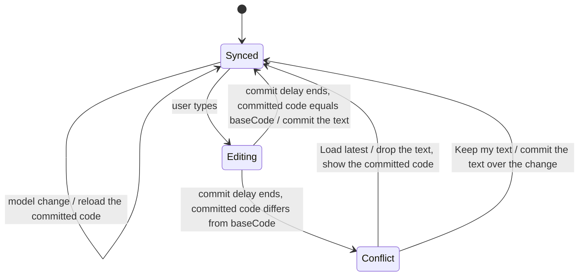

# WebMCP Phase 4: host and Shell integration

This phase connects the tools to the Modeler. It adds host actions, the Shell activity toast, the Code view conflict
state and the tool inspector story.

| Attribute         | Value                                                                                            |
| ----------------- | ------------------------------------------------------------------------------------------------ |
| Story             | [webmcp-story.md](../webmcp-story.md)                                                            |
| Recommended model | Opus. The phase changes the existing Shell and Code view behavior, and it wires the host routes. |
| Depends on        | Phases 2 and 3                                                                                   |

Read these sections of the main story before you start. Do not read the other phase files.

- [Component architecture](../webmcp-story.md#component-architecture)
- [Component folder layout](../webmcp-story.md#component-folder-layout)
- [Result envelope](../webmcp-story.md#result-envelope)
- [Tool catalog](../webmcp-story.md#tool-catalog)
- [Security](../webmcp-story.md#security)

## Technical Breakdown

`AgentActivityLog` exists from Phase 2 in `project/changes/agentActivityLog.ts`.

### Host and Shell contracts

```typescript
// project/projectHostActions.ts: the host capabilities, absent when the host does not give them.
interface ProjectHostActions {
  navigation?: ProjectToolsNavigation;
  save?: (baseVersion?: number) => Promise<ToolResult<SaveResultView>>; // only with `allowSave`
}

// src/components/shell/shell-types.ts: the Shell side of the activity log.
interface ShellAgentActivity {
  list(): readonly {changeId: string; summary: string; targets: string[]; regression?: {failed: number}}[];
  canUndo(changeId: string): boolean;
  undo(changeId: string): Promise<unknown>;
  subscribe(listener: () => void): () => void;
}
```

### The Shell shows agent activity

- The Shell gets the new prop `agentActivity?: ShellAgentActivity`. The host passes `ProjectToolsHandle.activity`.
- After each new agent change, the Shell shows a toast with `src/ui/Toast.tsx`. It shows the summary, the regression
  totals, "Undo" and "Show".
- The toast shows "Undo" only while `canUndo` is true. "Show" opens the first target in its default view.
- The Shell shows a "Companion is working" indicator from `toolactivated` until the tool returns or `toolcancel` fires.

### Agent writes and Code view drafts

Agent writes never wait for the user and never fail because of uncommitted Code view text. The Code view
(`src/components/shell/views/CodeView.tsx`) prevents a lost change instead.

- The Code view keeps `baseCode`: the committed code of its root when it loaded or last committed its text.
- For the root `*`, `baseCode` is the whole model. So each model change makes a pending commit a conflict.
- For an entry root, only a change of that entry makes a pending commit a conflict.
- The session keeps its DSL draft after an agent write. `get-project-overview` reports it as `draftPending`.

The Code view text moves through these states:



- In `Conflict`, the Code view shows a bar with the text `The model changed while you edited.`
- The bar has two actions: "Load latest" and "Keep my text".
- In `Conflict`, the Code view does not commit on its timer or on unmount. The text stays in the `drafts` map.
- "Keep my text" changes an undo target of the agent change. So an undo of that change fails with `UndoBlocked`.

### 13. `open-in-editor`

```text
Shows one project element to the user in the Modeler: a model entry or the README, in the code, boxed, flow, tests
or preview view. Use it to show the user the result of a change or the entry that an answer is about.
```

```typescript
interface OpenInEditorInput {
  path: SourcePath;
  view?: ShellView; // default: the default view of the entry kind
}

interface OpenResult {
  path: SourcePath;
  view: ShellView;
}
```

- A view that the Shell does not offer for the path fails with `InvalidInput`. `hint` lists the views of the path.
- The tool calls `navigation.open(path, view)`. The host updates its route as for a Project Explorer click.

### 14. `save-project`

```text
Saves the open project as a new revision in the workspace of the user. Changes stay only in this page until a save.
Use it when the user asks to save.
```

```typescript
interface SaveProjectInput {
  baseVersion?: number;
}

interface SaveResultView {
  revision: string;
  savedAt: string;
}
```

- The tool fails with `ParseError` while `dslValid` is false. It fails with `SaveConflict` on a repository conflict.
- `consequentialHint: true` makes the browser or agent ask the user before each call.

## Tasks

- [ ] Implement `ProjectHostActions`, `open-in-editor` and `save-project`
- [ ] Add `ShellAgentActivity` to `src/components/shell/shell-types.ts`
- [ ] Add the `agentActivity` prop, the toast and the working indicator to the Shell
- [ ] Add `baseCode`, the conflict state and the conflict bar to `CodeView.tsx`
- [ ] Reload the text of a `Synced` Code view on each model change
- [ ] Register the tools in `stories/support/modeler/ModelerHost.tsx` with a `ProjectToolsNavigation` from the routes
- [ ] Add `stories/components/webmcp/ToolInspector.stories.tsx`: it lists the tools and runs one with a JSON input
- [ ] Add tests for the code of this phase

Acceptance criteria:

- [ ] `npm test` passes, including `Shell.agentActivity.test.tsx`, `CodeView.conflict.test.tsx` and `hostTools.test.ts`
- [ ] `CodeView.conflict.test.tsx` shows that an agent change of the edited entry stops the timer commit and shows the
      bar
- [ ] In `npm run storybook`, the tool inspector runs `edit-model`, the toast shows the regression totals, and "Undo"
      reverts the change
- [ ] With `readOnly: true`, the tool inspector lists only the read tools and `open-in-editor`

## Verification

Run the commands of [Verification](../webmcp-story.md#verification) that this phase touches. At minimum:

```sh
npm run typecheck && npm run lint && npm run depcruise && npm test && npm run format:check
```
